# 03 — System Design and Architecture

| Field | Value |
|---|---|
| Document | `03_SYSTEM_DESIGN_AND_ARCHITECTURE.md` |
| Version | 1.0.0 |
| Date | 9 November 2026 |
| Status | **DRAFT — design only. No component described here has been built, deployed or tested.** |
| Audience | Architects, backend/frontend engineers, coding agents, security reviewers |
| Depends on | 01 (vocabulary §12, principles §9, decisions §19) |
| Related | 04 Backend · 05 Frontend · 07 AI · 08 PayPal/Security · 09 Testing/DevOps |

**Naming contract.** Component names in this document are used verbatim in docs 04–09: `Web App`, `API`, `Worker`, `PayPal Adapter`, `Webhook Gateway`, `Inbox`, `Outbox`, `Reducer`, `Reconciler`, `Orchestrator`, `Tool Gateway`, `Claim Validator`, `Policy Engine`, `Safe Action Engine`, `Projector`, `Notifier`, `Simulator`, `Fault Proxy`, `PostgreSQL`.

---

## Table of contents
1. [Architecture goals and driving constraints](#1-architecture-goals-and-driving-constraints)
2. [C4 Level 1 — System context](#2-c4-level-1--system-context)
3. [Trust boundaries](#3-trust-boundaries)
4. [C4 Level 2 — Containers](#4-c4-level-2--containers)
5. [C4 Level 3 — Components inside the Go modular monolith](#5-c4-level-3--components-inside-the-go-modular-monolith)
6. [Component responsibilities](#6-component-responsibilities)
7. [Who owns which truth](#7-who-owns-which-truth)
8. [Modular-monolith rationale](#8-modular-monolith-rationale)
9. [Data and event flows](#9-data-and-event-flows)
10. [Sequence diagrams (S1–S10)](#10-sequence-diagrams)
11. [State machines](#11-state-machines)
12. [Provider state vs PayBridge state](#12-provider-state-vs-paybridge-state)
13. [Failure modes and recovery](#13-failure-modes-and-recovery)
14. [Architecture decision records](#14-architecture-decision-records)
15. [Local demo topology and production evolution](#15-local-demo-topology-and-production-evolution)
16. [Cross-cutting concerns](#16-cross-cutting-concerns)

---

## 1. Architecture goals and driving constraints

**Core idea (SOURCE M10).** PayBridge is a payment-investigation SaaS with a **deterministic financial-control plane** and a **bounded AI analysis plane**. The merchant initiates checkout; **PayPal is the authoritative processor**; PayBridge owns *observational evidence, application reconciliation, case communication and diagnosis*. It never claims to own bank movement.

| Driver | Architectural consequence |
|---|---|
| Timeout ≠ failure | Three-dimension state vector; `UNKNOWN` is first-class; reconciliation is read-only |
| No blind retry | One-active-attempt lock; stable operation keys; mutator interface unreachable from AI |
| Provider is truth | Reducer ranks evidence tiers E1–E6; LLM output cannot write state |
| Two lenses, privacy | Projection-before-generation; separate data projections per role |
| Real vs simulated | `environment` enum on every row; isolated simulator namespace; SIMULATED never elevates trust (SOURCE I11) |
| Demonstrable fast | Modular monolith, SQL outbox, Render-deployable |
| AI optional for truth | Deterministic path complete without the LLM (Demo E) |

**Quality attributes (design targets — SOURCE M10 §10.6, *not measured*):** webhook HTTP ack < 2 s after durable inbox write; read-only case API p95 < 400 ms excluding cold starts; investigation queue-to-start < 10 s under test load; 100 % of confirmed financial claims cite provider-backed evidence; zero duplicate case-level financial effects in the synthetic regression suite.

---

## 2. C4 Level 1 — System context

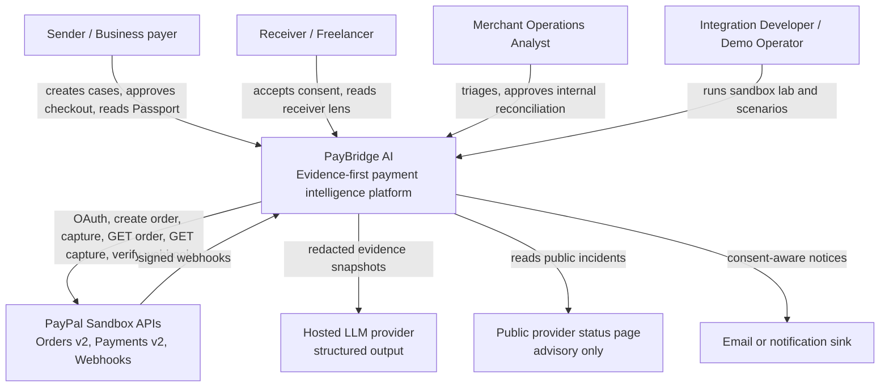

**Boundary statement.** Sender, receiver and operations see *permission-filtered* evidence. A provider event is **not** permission to reveal private funding or bank details to the opposite party (SOURCE M10 §10.1).

---

## 3. Trust boundaries

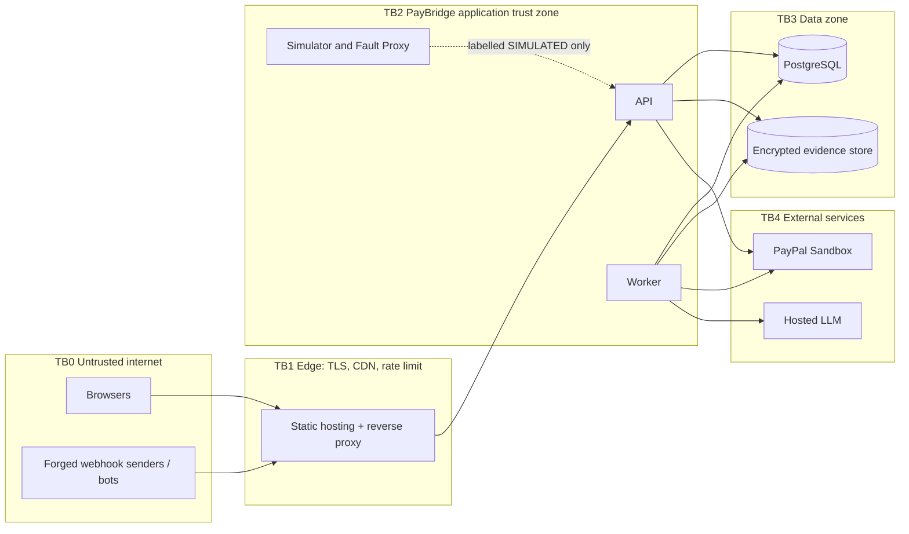

| Boundary | Crossing rule |
|---|---|
| TB0 → TB1/TB2 | Everything is hostile until authenticated: session cookie + CSRF for browser routes; PayPal signature for the webhook route; nothing else is public |
| TB2 → TB3 | App uses a **restricted DB role** (no `BYPASSRLS`); tenant context set via `SET LOCAL app.tenant_id` per transaction |
| TB2 → TB4 (PayPal) | Server-only secrets; allowlisted host; no browser-held client secret |
| TB2 → TB4 (LLM) | Only redacted, minimised snapshots leave TB2; worker is the **only** process with `LLM_API_KEY`; no financial credentials in the same process path as agent tools |
| AI plane ↔ control plane | The Orchestrator may *propose*; only the Safe Action Engine and Reducer *decide*. The Tool Gateway exposes read-only, case-scoped tools |
| Simulator → real data | One-way, labelled; simulator events can never raise evidence tier above E6 or overwrite real provider state |

---

## 4. C4 Level 2 — Containers

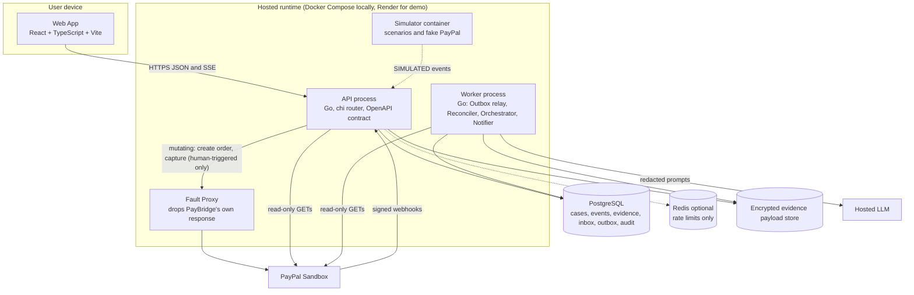

| Container | Responsibility | Scales by |
|---|---|---|
| Web App | Role-based UI; renders typed API only | CDN |
| API | AuthN/Z, case/checkout endpoints, webhook gateway, SSE, projections | Stateless replicas |
| Worker | Outbox relay, reconciliation, orchestration, notification delivery, retention jobs | Replicas using `SKIP LOCKED` leases |
| Simulator | Deterministic scenarios; fake PayPal for offline tests | Dev/test only |
| Fault Proxy | Demo-only toggle that discards PayBridge's capture *response* after the provider call succeeded (CHAOS-01) | Demo only; compiled out/disabled unless `FAULT_PROXY_ENABLED=true` and environment is sandbox |
| PostgreSQL | Durable PayBridge-owned records, append-only evidence, audit | Single primary (MVP) |
| Redis (optional) | Rate-limit counters, SSE fan-out hints. **Never financial truth** | — |

---

## 5. C4 Level 3 — Components inside the Go modular monolith

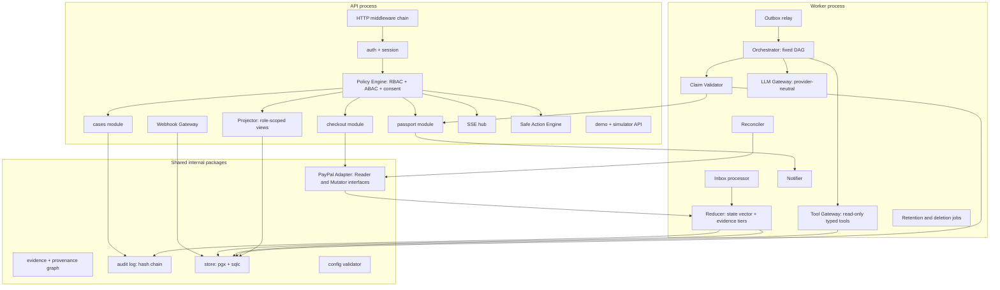

**Dependency rules (enforced by `depguard`/import tests, doc 04 §2):**
1. `orchestrator`, `agents`, `tools`, `llmgw` **must not import** `paypal` mutator code or `checkout`.
2. `reconciliation` may import only the **Reader** interface of `paypal`.
3. `projector` is the only package that builds role-facing payloads.
4. `reducer` is the only package that writes `provider_state`, `application_state`, `receiver_state`.
5. `webhook` writes only to `webhook_inbox`; it never mutates cases directly.

---

## 6. Component responsibilities

| Component | Owns | Never does |
|---|---|---|
| **Web App** | Rendering typed API data; route guards (UX only); SSE subscription | Hold PayPal secrets; compute payment state; show "failed" for unknown |
| **API / middleware** | Request id, logging, panic recovery, auth, CSRF, rate limit, validation, error envelope | Trust browser-supplied amounts |
| **Policy Engine** | Single authorisation decision point: actor × tenant × case × field × purpose × consent × environment | Decide from UI hints |
| **cases module** | Case CRUD, invitations, status workflow commands | Write provider state |
| **checkout module** | The *only* caller of PayPal Mutator: create order, capture; attempt locking; operation keys | Run from AI paths; retry captures under new keys |
| **PayPal Adapter** | Token lifecycle; typed requests; error classification into `success / explicit_decline / pending / unknown`; request-id header | Expose mutators to non-checkout code |
| **Webhook Gateway** | Raw-byte capture, size limit, signature verification, durable inbox insert, then 2xx | Acknowledge before persistence; mutate cases |
| **Inbox processor** | Claim rows (lease), correlate resource → case, normalise, call Reducer | Process unverified rows as financial truth |
| **Reducer** | Pure-ish state transition function over evidence; monotonic provider-state rules; optimistic version check | Accept LLM or simulated input as provider truth |
| **Reconciler** | Read-only re-read of original order/capture; compare amount/currency/merchant; emit evidence | Create or capture anything |
| **Outbox relay** | Turn committed outbox rows into jobs (investigation, notification, retention) | Run outside the DB transaction guarantee |
| **Orchestrator** | Fixed DAG, per-case snapshot version, budget/timeouts, merges agent outputs | Spawn agents recursively; pick tenants; hold financial credentials |
| **Tool Gateway** | Typed, scoped, redacted, read-only evidence tools | Write to DB; fetch arbitrary URLs |
| **LLM Gateway** | Provider-neutral calls; schema-constrained output; retries/timeouts; token accounting | Log raw prompts with PII |
| **Claim Validator** | Schema + citation + tier + privacy + temporal gate | Be bypassed |
| **Safe Action Engine** | Deterministic action catalogue gated by evidence class and state | Take its recommendation from the LLM |
| **Projector** | Role-scoped data projections (Sender / Receiver / Ops) *before* text generation | Include fields outside the role allowlist |
| **passport module** | Versioned Passport generation from validated claims + projections | Publish unvalidated claims |
| **Notifier** | Consent-aware notices; delivery records | Notify a revoked receiver |
| **Simulator / Fault Proxy** | Reproducible labelled scenarios | Mix ids into the real namespace |

---

## 7. Who owns which truth

*(SOURCE M10 §10.2, normalised.)*

| System | Can establish | Cannot establish | PayBridge behaviour |
|---|---|---|---|
| PayPal Orders/Payments (E1) | Order/capture/refund state for the accessible merchant integration | Downstream settlement / bank posting | Record observation with source/time |
| Signed webhook (E2) | An authenticated notification that an event occurred | Exactly-once or ordered delivery | Verify, dedupe, reconcile |
| Merchant order system (E3) | Invoice, cart, fulfilment state | Whether PayPal captured if the app lost the response | Separate domain: `application_state` |
| Browser/client | UX and redirect state | Financial completion from a timeout | Show *pending verification*, never failure |
| Receiver's authorised account | Limited availability signals **if** a supported connector + consent exist | PayPal/bank internals | Not available in MVP → `NOT_OBSERVABLE` |
| Public status page (E4) | Provider-reported incidents | Status of one payment | Advisory only |
| PayBridge instrumentation | Latency/errors *seen by PayBridge* | PayPal internal queues or global traffic | Label source and scope |
| LLM (E6) | Interpretation and hypotheses | Financial authority, hidden decline causes, compliance verdicts | Evidence-linked claims only |

---

## 8. Modular-monolith rationale

*(DESIGN DECISION, SOURCE ADR-005.)*

- **Why not microservices:** the hardest problem here is *correctness across asynchronous boundaries*, not independent scaling. Splitting early adds network failure modes to the very thing we are trying to reason about.
- **Why two processes:** `api` and `worker` scale and fail independently (a slow LLM must never delay webhook acknowledgements) while sharing one codebase, one schema and one deployment pipeline.
- **Why SQL outbox:** the case-state write and the job-intent write commit **atomically**. No dual-write window; no lost investigation. A broker (NATS JetStream / SQS) is a later swap behind the `outbox.Relay` interface once there is a measured need.
- **When to split (triggers):** webhook ingest throughput exceeds a single API replica; LLM spend/latency requires an isolated service; team ownership boundaries emerge; compliance requires isolating the agent plane. Until then: explicit packages + import rules.

---

## 9. Data and event flows

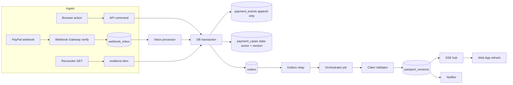

**Event envelope** (`paybridge.event.v1`, SOURCE M11 §11.5): `event_id, event_schema, case_id, source, source_trust, environment, event_type, provider_resource{type,id}, occurred_at, observed_at, verified, payload_sha256, redacted`. Full JSON Schema in doc 04 §16 and `packages/contracts/event.schema.json`.

**Atomicity rule (DESIGN DECISION).** Every state-changing path performs, in **one DB transaction**: (1) insert evidence/event, (2) run Reducer and update the case with optimistic `state_version` check, (3) insert outbox rows, (4) insert audit record. Side effects (LLM, email, SSE) happen only after commit, driven by the outbox.

---

## 10. Sequence diagrams

Participants (consistent everywhere): `Browser`, `Web` (Web App), `API`, `DB` (PostgreSQL), `FP` (Fault Proxy), `PP` (PayPal Sandbox), `WG` (Webhook Gateway), `WK` (Worker), `REC` (Reconciler), `ORC` (Orchestrator), `LLM`.

### S1 — Payment creation and capture (happy path, SANDBOX)

```mermaid
sequenceDiagram
  autonumber
  actor Sender
  participant Web
  participant API
  participant DB
  participant PP as PayPal Sandbox
  Sender->>Web: Start checkout for invoice
  Web->>API: POST /cases/{id}/orders  (Idempotency-Key)
  API->>DB: authorise; assert no active attempt; insert attempt + operation_request_id
  API->>PP: POST /v2/checkout/orders  (PayPal-Request-Id: stable)
  PP-->>API: 201 order id, approval link
  API->>DB: persist provider_order_id, evidence E1, attempt ORDER_CREATED
  API-->>Web: approval context only
  Sender->>PP: Approve in PayPal hosted flow
  PP-->>Web: redirect back (approved)
  Web->>API: POST /cases/{id}/capture  (Idempotency-Key)
  API->>DB: lock attempt FOR UPDATE; verify approved; attempt CAPTURE_REQUESTED
  API->>PP: POST /v2/checkout/orders/{order}/capture (PayPal-Request-Id: stable)
  PP-->>API: 201 COMPLETED, capture id
  API->>DB: verify amount and currency vs case; evidence E1; provider CAPTURE_COMPLETED; passport v1
  API-->>Web: confirmed (receiver bank: NOT_OBSERVABLE)
```

### S2 — Capture succeeds, application confirmation lost (the golden failure; SANDBOX + controlled fault)

```mermaid
sequenceDiagram
  autonumber
  actor Sender
  participant Web
  participant API
  participant DB
  participant FP as Fault Proxy
  participant PP as PayPal Sandbox
  participant WK as Worker
  Sender->>Web: Confirm payment
  Web->>API: POST /cases/{id}/capture
  API->>DB: lock attempt; CAPTURE_REQUESTED; stable request id
  API->>FP: capture request
  FP->>PP: POST capture
  PP-->>FP: 201 COMPLETED
  Note over FP: CHAOS-01 fault: response discarded
  FP--xAPI: no response (timeout)
  API->>DB: attempt CAPTURE_UNKNOWN; application API_TIMEOUT; provider UNKNOWN (last confirmed APPROVED); outbox: reconcile
  API-->>Web: 202 outcome UNKNOWN - do not pay again
  Web-->>Sender: Do not repeat banner (never shows failed)
  WK->>DB: claim reconcile job
  Note over WK: continues in S5
```

### S3 — Webhook arrives before / after the API response

```mermaid
sequenceDiagram
  autonumber
  participant PP as PayPal Sandbox
  participant WG as Webhook Gateway
  participant DB
  participant WK as Worker
  participant API
  Note over PP,API: Case A: webhook BEFORE the capture response is persisted
  PP->>WG: POST webhook PAYMENT.CAPTURE.COMPLETED
  WG->>WG: verify signature on raw bytes
  WG->>DB: insert inbox row (unique provider_event_id)
  WG-->>PP: 200
  WK->>DB: claim row; correlate resource to case
  alt case/attempt has no provider ids yet
    WK->>DB: park row as UNCORRELATED; schedule bounded re-check
  else attempt found
    WK->>DB: append event; Reducer applies; version check
  end
  API->>DB: later persists its own response; Reducer sees state already COMPLETED; no regression
  Note over PP,API: Case B: webhook AFTER the API response
  API->>DB: provider CAPTURE_COMPLETED via E1
  PP->>WG: webhook arrives
  WG->>DB: inbox insert
  WK->>DB: Reducer: same state; append evidence E2; no duplicate notification
```

### S4 — Duplicate and out-of-order webhooks

```mermaid
sequenceDiagram
  autonumber
  participant PP as PayPal Sandbox
  participant WG as Webhook Gateway
  participant DB
  participant WK as Worker
  PP->>WG: event E-2 CAPTURE.COMPLETED (id=ev2)
  WG->>DB: insert inbox ev2
  WK->>DB: Reducer: provider CAPTURE_COMPLETED
  PP->>WG: event E-1 CAPTURE.PENDING (id=ev1, older occurred_at)
  WG->>DB: insert inbox ev1
  WK->>DB: Reducer: append evidence; provider stays CAPTURE_COMPLETED (monotonic rule)
  PP->>WG: event E-2 again (id=ev2 retry)
  WG->>DB: insert conflicts on unique key
  WG->>DB: increment duplicate_count; return 200
  Note over WK,DB: one logical effect; duplicate receipt stays observable
```

### S5 — Reconciliation (read-only)

```mermaid
sequenceDiagram
  autonumber
  participant WK as Worker
  participant REC as Reconciler
  participant DB
  participant PP as PayPal Sandbox
  WK->>REC: reconcile(case_id)
  REC->>DB: load original attempt, order id, request ids, capture ids
  alt no original identifiers
    REC->>DB: case NEEDS_HUMAN_REVIEW (no arbitrary search)
  else identifiers present
    REC->>PP: GET /v2/checkout/orders/{order_id}
    PP-->>REC: order (status, purchase units, capture refs)
    opt capture reference present
      REC->>PP: GET /v2/payments/captures/{capture_id}
      PP-->>REC: capture status
    end
    REC->>REC: compare amount, currency, merchant ids vs case
    REC->>DB: tx: evidence E1; Reducer; outbox: investigate; audit
    alt capture COMPLETED and application UNKNOWN or failed
      REC->>DB: application INCONSISTENT; open APPLICATION_DIVERGENCE investigation
    else capture PENDING
      REC->>DB: schedule bounded follow-up
    else contradictory
      REC->>DB: case NEEDS_HUMAN_REVIEW
    else inconclusive
      REC->>DB: keep UNKNOWN with last verified timestamp
    end
  end
  Note over REC: Reader interface has no POST methods
```

### S6 — Unknown outcome (no provider id was saved)

```mermaid
sequenceDiagram
  autonumber
  participant API
  participant DB
  participant PP as PayPal Sandbox
  participant WK as Worker
  API->>DB: attempt ORDER_CREATING; operation_request_id stored first
  API->>PP: POST create order (PayPal-Request-Id)
  PP--xAPI: connection lost, no order id seen
  API->>DB: attempt ORDER_UNKNOWN
  API-->>API: response 202 unknown, no second create
  WK->>DB: claim ORDER_UNKNOWN reconcile
  alt authorised lookup by original reference possible
    WK->>PP: safe lookup (read-only)
    WK->>DB: ORDER_CREATED with original id
  else not possible
    WK->>DB: REVIEW_REQUIRED; case NEEDS_HUMAN_REVIEW
  end
  Note over API,WK: A new order requires an explicit human decision after the prior attempt is terminal or abandoned
```

### S7 — AI investigation

```mermaid
sequenceDiagram
  autonumber
  participant DB
  participant WK as Worker
  participant ORC as Orchestrator
  participant TG as Tool Gateway
  participant LLM
  participant CV as Claim Validator
  participant PS as passport module
  WK->>DB: outbox job: investigate(case, snapshot_version=7)
  WK->>ORC: run with immutable evidence snapshot
  ORC->>ORC: policy router picks agents for trigger checkout.response_timeout
  ORC->>TG: A05 Journey Tracker tools (deterministic)
  TG->>DB: read-only, case-scoped, redacted
  par parallel analyses where permitted
    ORC->>LLM: A03 Sender Analysis (redacted snapshot)
    ORC->>LLM: A02 Service Intelligence (if useful)
  end
  ORC->>LLM: A06 Root Cause Analyst with merged findings
  LLM-->>ORC: structured claims JSON
  ORC->>CV: schema + citation + tier + privacy + temporal checks
  alt snapshot version changed during run
    CV-->>ORC: stale, discard and rerun
  else valid
    CV-->>ORC: accepted claims; unsupported ones downgraded to unknown
  end
  ORC->>LLM: A08 Recovery Planner (rule-catalogue-bounded)
  ORC->>LLM: A09 Dual-Side Communicator (per-role projections)
  ORC->>CV: output DLP and role privacy gate
  CV->>PS: publish versioned Passport + notifications
  PS->>DB: tx: passport_versions, audit, outbox
```

### S8 — Role-specific explanations (Two-Lens)

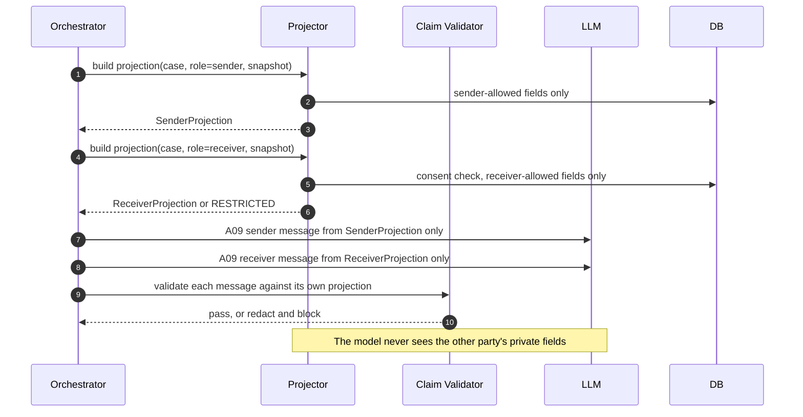

### S9 — Consent and access revocation

```mermaid
sequenceDiagram
  autonumber
  actor Merchant as Sender or Merchant
  actor Receiver
  participant Web
  participant API
  participant PE as Policy Engine
  participant DB
  participant WK as Worker
  Merchant->>API: POST /cases/{id}/receiver-invite
  API->>DB: invite (scoped fields, expiry, hashed token)
  Receiver->>API: POST /invites/{token}/accept (authenticated)
  API->>PE: verify intended receiver identity
  API->>DB: consent_grant (field allowlist, version); audit
  Receiver->>API: GET /cases/{id}/passport (receiver lens)
  API->>PE: authorise with active consent
  API-->>Receiver: receiver-safe Passport
  Receiver->>API: POST /consents/{id}/revoke
  API->>DB: tx: grant revoked; share tokens revoked; sessions scoped; outbox: cancel pending notices; audit
  WK->>DB: cancel unsent notifications
  Receiver->>API: GET /cases/{id}/passport
  API->>PE: authorise
  PE-->>API: deny
  API-->>Receiver: 404 (uniform, no existence disclosure)
  Note over API,DB: Already delivered messages cannot be recalled
```

### S10 — Counterfactual Recovery Mirror (SIMULATED)

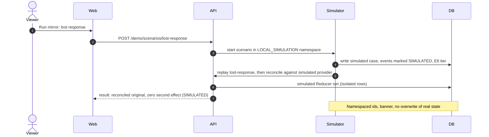

---

## 11. State machines

### 11.1 Attempt (checkout) machine — SOURCE M13 §13.2

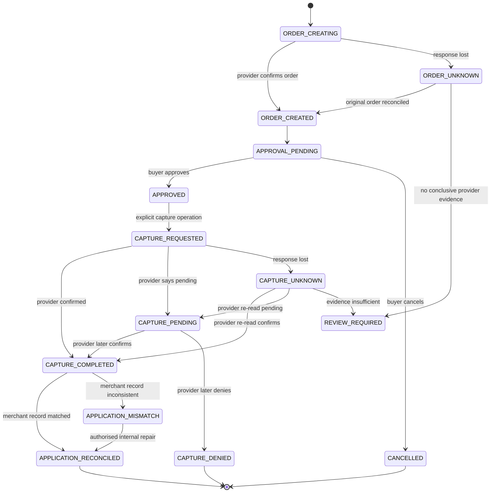

**Forbidden transitions (enforced in code + tests, doc 04 §15):** any `*_UNKNOWN → CAPTURE_DENIED/CANCELLED` without a provider read saying so; `CAPTURE_COMPLETED →` any pre-capture state; `CAPTURE_DENIED → CAPTURE_COMPLETED` (a new attempt is required); any transition caused by a `SIMULATED` event on a `REAL_SANDBOX` case.

### 11.2 Case workflow machine — SOURCE M13 §13.3 + decision D-04

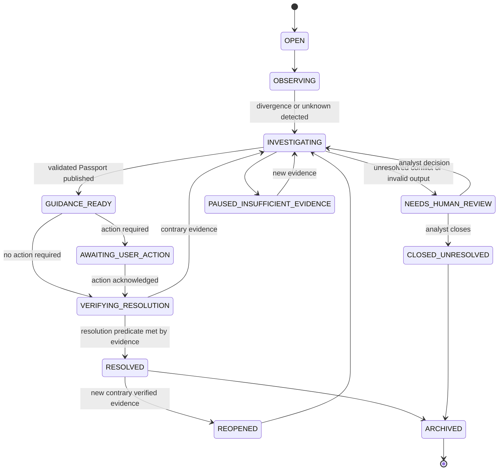

Every transition records **cause, actor, evidence reference, version** (SOURCE).

### 11.3 Application observation lane

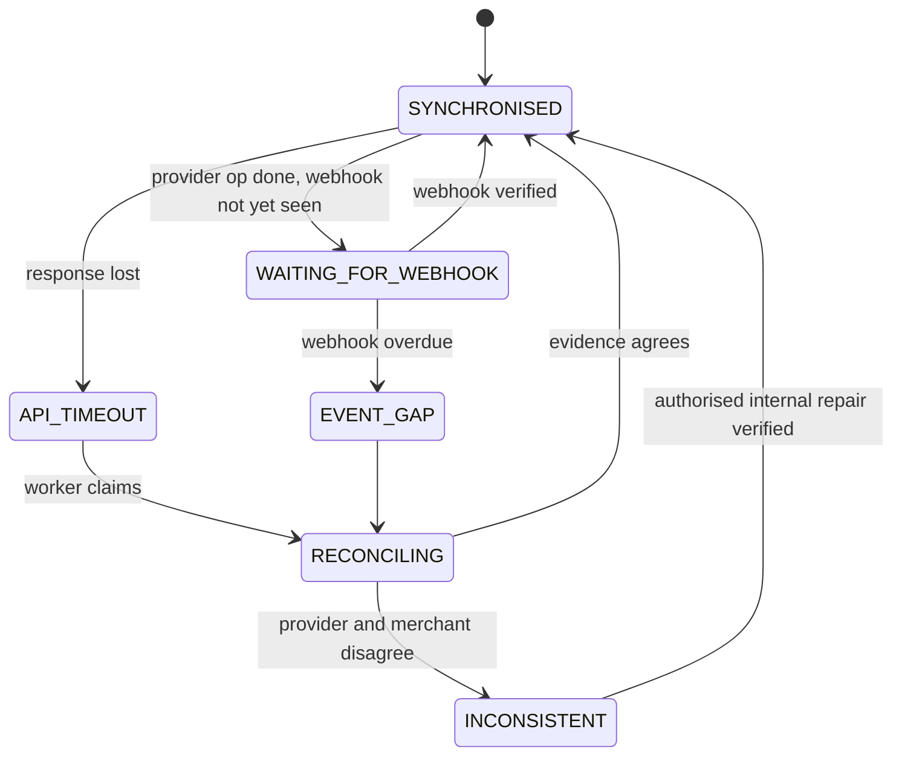

---

## 12. Provider state vs PayBridge state

| Dimension | Owner of truth | Written by | Never written by |
|---|---|---|---|
| `provider_state` | PayPal (E1/E2) | Reducer from verified evidence | LLM, user input, simulator on a real case |
| `application_state` | PayBridge/merchant observation (E3) | Reducer from app traces and reconciliation | LLM |
| `receiver_state` | Receiver's authorised signals | Reducer from a supported connector; default `NOT_OBSERVABLE` | LLM; inferred from `CAPTURE_COMPLETED` (I6) |
| `case_status` | PayBridge workflow | Case commands + deterministic predicates | LLM confidence |

**Precedence examples (SOURCE annex §8):**

| Incoming evidence | Existing | Result |
|---|---|---|
| Browser sees capture timeout | `APPROVED` | `application=API_TIMEOUT`, `provider=UNKNOWN (last_confirmed=APPROVED)`, queue lookup |
| Verified `PAYMENT.CAPTURE.COMPLETED` | `CAPTURE_PENDING` | `CAPTURE_COMPLETED`, event recorded |
| Same webhook id again | `CAPTURE_COMPLETED` | No transition; duplicate counted |
| Simulated `CAPTURE_DENIED` | Real `CAPTURE_COMPLETED` | Real preserved; simulator row isolated |
| Authenticated capture GET `COMPLETED` after timeout | `API_TIMEOUT` | Reconcile same attempt; no new charge |
| Buyer says "bank deducted money" | `UNKNOWN` | Stored as `USER_REPORTED` (E5); not provider-confirmed |
| Old `PENDING` after newer `COMPLETED` | `CAPTURE_COMPLETED` | Append evidence; state preserved |
| Verified refund after completed | `CAPTURE_COMPLETED` | Refund dimension updated from verified event (not an irreversible chain) |

**Monotonic rule (DESIGN DECISION).** `provider_state` may only move along the lattice implied by verified evidence time and a documented reversal table (`COMPLETED → REFUNDED/PARTIALLY_REFUNDED` via verified refund/reversal events). Reordering alone must never regress state.

---

## 13. Failure modes and recovery

| ID | Failure | Detection | Containment | Recovery |
|---|---|---|---|---|
| FM-01 | Capture response lost after provider success | Timeout/5xx in `checkout` | Attempt locked; retry button disabled; banner | Reconciler re-reads order/capture (S5) |
| FM-02 | Order-create response lost | `ORDER_CREATING` stale | No second create | Safe lookup or human review (S6) |
| FM-03 | DB commit fails after provider capture | Tx error after provider 2xx | Operation key already persisted *before* call | Reconcile; repair (CHAOS-11) |
| FM-04 | Webhook endpoint down | PayPal retries; inbox lag gauge | n/a | Reconciler polls; replay from supported sources |
| FM-05 | Forged webhook | Signature/cert/webhook-id check fails | Reject; inbox row `REJECTED` | Alert on spike |
| FM-06 | Duplicate/out-of-order webhook | Unique key / monotonic reducer | No effect | None needed |
| FM-07 | Worker crash mid-job | Lease expiry | Idempotent handlers | Another worker re-claims |
| FM-08 | LLM down/slow/invalid | Timeout/schema failure | Deterministic Passport still served | Queue/retry; Demo E |
| FM-09 | Prompt injection in invoice memo | Injection eval + schema | Data-only handling; no tools beyond allowlist | Human review flag |
| FM-10 | Cross-tenant/IDOR attempt | Policy Engine + RLS | Uniform 404; audit | Alert; revoke |
| FM-11 | Provider/currency mismatch vs invoice | Reconciler compare | Block success label | Analyst review (CHAOS-12) |
| FM-12 | Stale snapshot during agent run | Snapshot version compare | Discard output | Rerun on latest |
| FM-13 | Public provider incident | A02 advisory | Never auto-fail cases | Label advisory |
| FM-14 | Postgres outage | Health probes | API returns 503 *without* acknowledging webhooks | PITR restore drill |
| FM-15 | Consent revoked mid-investigation | Revocation event | Cancel unsent notices; deny reads | CHAOS-09 |

**Recovery principle.** Unknown → read-only re-observation → deterministic reducer → human escalation. **Never** "make it work" by issuing a new mutating call.

---

## 14. Architecture decision records

| ID | Decision | Status | Source |
|---|---|---|---|
| ADR-001 | PayPal owns financial truth; local state cannot override verified provider state | Accepted | SOURCE |
| ADR-002 | Separate `provider_state`, `application_state`, `receiver_state`; no single universal status | Accepted | SOURCE |
| ADR-003 | PostgreSQL append-only evidence + unique idempotency keys, not mutable JSON-only records | Accepted | SOURCE |
| ADR-004 | React web-first; responsive sender/receiver + desktop ops | Accepted | SOURCE |
| ADR-005 | Go-first modular monolith; explicit boundaries; no premature microservices | Accepted | SOURCE |
| ADR-006 | Hosted LLM through an isolated gateway; model cannot send money | Accepted | SOURCE |
| ADR-007 | Every automated explanation cites case evidence and states unknowns | Accepted | SOURCE |
| ADR-008 | Real sandbox and local simulation never share indistinguishable UI/ID namespaces | Accepted | SOURCE |
| ADR-009 | Tenant boundaries in application **and** PostgreSQL RLS | Accepted | SOURCE |
| ADR-010 | No claims of internal PayPal traffic, risk signals, or bank settlement without authorised APIs | Accepted | SOURCE |
| **ADR-011** | **HTTP router: `chi`.** Rationale: stdlib-compatible `http.Handler` middleware, route-grouping and `context` values suit a policy-per-route design; minimal dependency; mature. Alternative `net/http` (Go 1.22+ pattern routing) remains viable — revisit if dependency minimisation outweighs middleware ergonomics. Version **VERIFY** | Accepted | DESIGN DECISION |
| **ADR-012** | **Realtime: SSE with polling fallback.** One-way server→client fits Passport/timeline updates; works over plain HTTP, simple auth with cookies, auto-reconnect with `Last-Event-ID`; WebSockets add bidirectional complexity we do not need | Accepted | DESIGN DECISION |
| **ADR-013** | **MVP auth: server-side session cookies** (HttpOnly, Secure, SameSite=Lax) with seeded demo identities; OIDC adapter interface prepared for production | Accepted | DESIGN DECISION |
| **ADR-014** | **Data access: pgx v5 + sqlc** (typed SQL) and **goose** migrations; no heavy ORM, to keep constraints/RLS explicit | Accepted | DESIGN DECISION |
| **ADR-015** | **Reducer is the only writer of state dimensions**; LLM/simulator/browser can only append evidence | Accepted | DESIGN DECISION |
| **ADR-016** | **PayPal client split into `Reader` and `Mutator` interfaces**; only `checkout` receives a `Mutator` | Accepted | DESIGN DECISION |
| **ADR-017** | **Fault Proxy lives in PayBridge's own response path**, not in PayPal; compiled behind a build flag and disabled outside `REAL_SANDBOX`/dev | Accepted | DESIGN DECISION |
| **ADR-018** | **Passport is append-only versioned**; prior versions remain auditable | Accepted | SOURCE (concept) |
| **ADR-019** | **Hash-chained audit** in Postgres with restricted role; no blockchain | Accepted | SOURCE annex §9 |
| **ADR-020** | **OpenAPI is the contract source of truth**; Go and TS types generated | Accepted | Owner prompt |
| **ADR-021** | **Webhook signature verification is a separate `WebhookVerifier` interface**, not part of `Reader`, so `Reader` is provably GET-only (corrects an internal inconsistency; see doc 01 D-14) | Accepted | DESIGN DECISION (Account 2 audit, 2026-11-09) |

---

## 15. Local demo topology and production evolution

### 15.1 Local (Docker Compose) — DESIGN
```text
docker compose up:
  postgres (+ volume)          :5432
  redis (profile: optional)    :6379
  api   (go run / container)   :8080
  worker                       (no port)
  web   (vite dev)             :5173
  simulator + fake-paypal      :8090   (profile: sim)
  mailsink                     :8025   (profile: dev)
  otel-collector               (profile: obs)
Public webhook testing: a tunnel (e.g. a tunnelling tool) mapping https://<tunnel>/api/v1/webhooks/paypal → :8080 (**VERIFY** chosen tool and PayPal's acceptance of the URL)
```

### 15.2 Hosted demo (Render) — DESIGN
Static Site (Web App) · Web Service (API) · Background Worker (Worker) · Managed PostgreSQL. **Do not allow the API to sleep** — webhook delivery needs a stable, always-on HTTPS endpoint (SOURCE M10.4). Verify plan features/cost before choosing (**VERIFY**).

### 15.3 Production-oriented AWS reference — DESIGN ONLY (not provisioned)

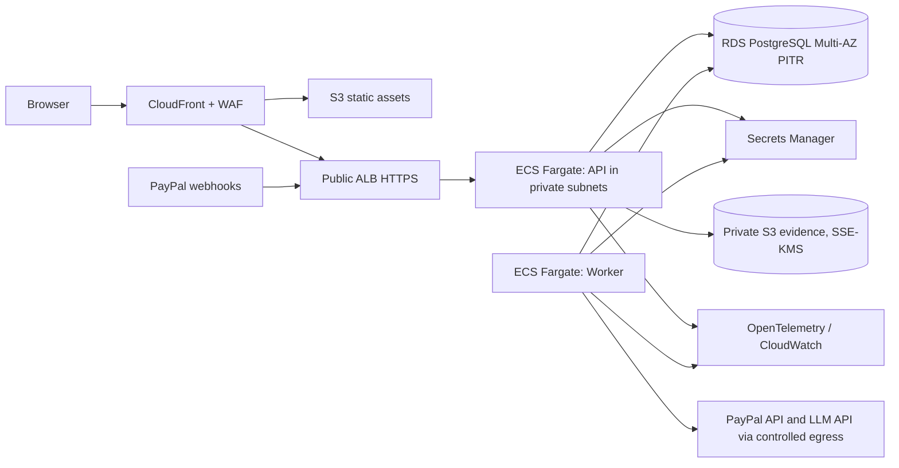

### 15.4 Evolution path (triggers → change)
| Trigger | Change |
|---|---|
| Measured queue backlog | Swap SQL outbox relay for NATS JetStream/SQS behind `outbox.Relay` |
| LLM cost/latency or compliance isolation | Extract Orchestrator into its own service; keep Tool Gateway contract |
| Throughput | Read replicas for projections; partition `payment_events` by month |
| Enterprise customers | SSO/OIDC, per-tenant keys, regional data residency |
| More providers | Additional `ProviderAdapter` implementations (Reader/Mutator split already in place) |

---

## 16. Cross-cutting concerns

**Observability (design):** every request/job carries `correlation_id` (+ OpenTelemetry trace). Metrics: webhook inbox backlog, signature failures, unknown-state backlog age, reconcile latency, agent token use/latency/rejections, SSE connections, DB retries. Detail in doc 04 §21 and doc 09.

**Configuration:** a startup validator fails fast with *names only* of missing variables; refuses to start if `PAYPAL_ENV != sandbox` (PRODUCTION hard-disabled).

**Error taxonomy:** provider responses classify into `success | explicit_decline | pending | unknown_missing_response` (SOURCE M16 §16.3); only the first three are ever shown as definite.

**Time:** UTC everywhere; both `provider_occurred_at` and `received_at` are stored; UI localises.

**Security alignment:** threat model and controls in doc 08; testability hooks (CHAOS-01…12, privacy, IDOR, forged webhook) in doc 09.

*End of document 03.*
