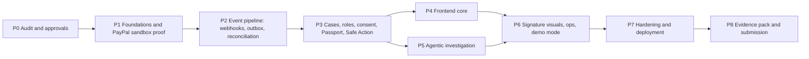

# 10 — Implementation Roadmap, Acceptance and Demo

| Field | Value |
|---|---|
| Document | `10_IMPLEMENTATION_ROADMAP_ACCEPTANCE_AND_DEMO.md` |
| Version | 1.0.0 |
| Date | 9 November 2026 |
| Status | **DRAFT — plan. No task below has been started. Every status cell is NOT STARTED.** |
| Audience | Owner, coding agents, any human collaborators, hackathon reviewers |
| Depends on | 01 (scope, AO-xx), 02 (phases, report template), 03–09 (specs, tests, release gates) |
| Labels | SOURCE · DESIGN DECISION · VERIFY · SANDBOX · SIMULATED |

> **Scheduling note:** the plan gives dependency order and gates, **not dates or effort estimates** (SOURCE M18). The hackathon deadline is **unknown to this blueprint — VERIFY it on the official page first** and then choose which SHOULD items to cut; MUST items are never cut.

## Table of contents
1. [Roadmap overview](#1-roadmap-overview) · 2. [Priorities: MUST / SHOULD / LATER](#2-priorities-must--should--later) · 3. [Epics, tasks and dependencies](#3-epics-tasks-and-dependencies) · 4. [Milestones and gates](#4-milestones-and-gates) · 5. [Ownership and conflict avoidance](#5-ownership-and-conflict-avoidance) · 6. [Phase acceptance criteria and definition of done](#6-phase-acceptance-criteria-and-definition-of-done) · 7. [Risk register](#7-risk-register) · 8. [Decisions and open questions](#8-decisions-and-open-questions) · 9. [Golden demo (Demo B) script](#9-golden-demo-demo-b-script) · 10. [Competition demo storyboard](#10-competition-demo-storyboard) · 11. [Labelled fixtures](#11-labelled-fixtures) · 12. [Evidence pack](#12-evidence-pack) · 13. [Pitch outline](#13-pitch-outline) · 14. [Honest claims checklist](#14-honest-claims-checklist) · 15. [Handoff checklist](#15-handoff-checklist) · 16. [Blueprint consistency audit](#16-blueprint-consistency-audit)

---

## 1. Roadmap overview

| Phase | Outcome | Gate (all evidenced) |
|---|---|---|
| **P0** | Blueprint approved; repo audited; env/key **names** inventoried; PayPal sandbox accounts + LLM key obtained by owner | Owner approval of docs 01–10 and the audit report |
| **P1** | Repo skeleton, Compose, config guard, migrations 0001–0003, PayPal OAuth + Reader/Mutator, create/capture, show order/capture | **Real sandbox order + capture recorded**, independent GET matches, secrets scan clean (AO-01, AO-14) |
| **P2** | Evidence/events/Reducer, webhook inbox/verify/dedupe, outbox/workers, Reconciler, fake PayPal + simulator basics | SIM-01…10 pass; forged webhook rejected; reconcile issues 0 POSTs (AO-02 SIM form, AO-04, AO-05) |
| **P3** | Auth/sessions/RBAC/ABAC/RLS, consent/invites/shares, projector, Passport versioning, Safe Action Engine, Truth Gap builder, audit chain, SSE | Privacy/IDOR/tenant tests pass (AO-08, AO-09) |
| **P4** | Frontend core: landing, auth, dashboard, new payment, case shell + Passport, timeline, lenses, safe-action panel, SSE | Golden path usable on **real API** at 1440/1024/390 (FE-01…FE-05) |
| **P5** | Orchestrator, A01–A10, tools, validator, fallback, evals | Eval report with suite size & failures; Demo E works (AO-06, AO-07, AO-10) |
| **P6** | Truth Gap workbench, Mirror lab, evidence explorer, ops console, notifications, settings, demo selector, Fault Proxy | Demo B end-to-end on sandbox (AO-02 real form) |
| **P7** | Security suite, observability/alerts, CI gates, Render deployment, backup drill, runbooks, a11y pass | Release gates RG-01…RG-12 (doc 09) |
| **P8** | Evidence pack, video, README, licence, claims checklist | Checklist signed; submission artefacts complete |

---

## 2. Priorities: MUST / SHOULD / LATER

| Level | Meaning | Items |
|---|---|---|
| **MUST** | Without these there is no credible golden demo | C01–C09, C15 (doc 01 §14): real sandbox checkout; case/attempt/event spine; reconciliation; webhook safety; Passport; two lenses + consent; Safe Action Engine; agents A01–A10 with validator + fallback; Truth Gap Graph; demo selector; honest labelling; deployed hosted demo; evidence pack |
| **SHOULD** | Strengthens judging if time permits | C10 Recovery Mirror lab; C11 ops console depth; C12 public status advisory; C13 FX explanation; C14 SSE (polling fallback is MUST-acceptable); landing page polish; dark theme; visual-regression baselines; load test |
| **LATER** | Out of the hackathon build | Real receiver connectors; bank settlement evidence; refunds; CRM/accounting integrations; predictive models; PWA/native; OIDC IdP; multi-region; broker (NATS/SQS) |

**Cut order if time runs short (first to cut → last):** load test → dark theme polish → visual-regression baselines → FX (A07) → public status (A02 live fetch; keep static advisory) → ops console depth → Mirror lab depth (keep minimal lost-response scenario) → landing animation (keep static). **Never cut:** reconcile-no-retry proof, webhook verification, Truth Gap Graph, two lenses with consent, evidence labelling, honest claims.

---

## 3. Epics, tasks and dependencies

*Task ids are stable handles for the task template (doc 02 §19). "Deps" are prerequisite task ids. Doc refs show where the spec lives.*

### E0 — Audit and approvals (P0)
| Task | Description | Deps | Spec |
|---|---|---|---|
| T0.1 | Repository audit (§4 of doc 02); env/key **name** inventory | – | 02 |
| T0.2 | Owner obtains PayPal sandbox app (Client ID/Secret), buyer+merchant sandbox accounts, webhook ID; LLM key | – | 08 §1 |
| T0.3 | Confirm hackathon rules/deadline/licence/video constraints | – | 01 §23 |
| T0.4 | Approve blueprint; resolve open questions §8 | T0.1 | – |

### E1 — Foundations & PayPal proof (P1)
| Task | Description | Deps | Spec |
|---|---|---|---|
| T1.1 | Repo skeleton, Makefile, `.gitignore`, `.env.example`, gitleaks hook, CI skeleton | T0.4 | 02 §7, 09 |
| T1.2 | Config validator (names-only errors; PRODUCTION guard) | T1.1 | 04 §1, 08 §8 |
| T1.3 | Compose (Postgres), migrations 0001–0003, `store`/sqlc, tx + RLS helper, constraint tests | T1.1 | 04 §11 |
| T1.4 | `money`, `ids`, `redact`, `clock` packages + tests | T1.1 | 04 §2 |
| T1.5 | PayPal adapter: OAuth, Reader, Mutator, classifier, request-id discipline, fake PayPal | T1.2, T1.4 | 04 §9 |
| T1.6 | `checkout`: create order, approval hand-off, capture with lock, unknown handling (`202 UNKNOWN`) | T1.3, T1.5 | 03 S1/S2 |
| T1.7 | **Real sandbox receipt**: create→approve→capture→GET order/capture (manual run) | T1.6, T0.2 | 08 §1 |
| T1.8 | OpenAPI skeleton + codegen pipeline (Go + TS) + CI drift check | T1.1 | 04 §22 |

### E2 — Event pipeline (P2)
| Task | Description | Deps | Spec |
|---|---|---|---|
| T2.1 | Migrations 0004–0005; evidence/events; Reducer + transition tests | T1.3 | 04 §15 |
| T2.2 | Webhook Gateway + verify + inbox; Inbox processor; duplicate/out-of-order/forged tests | T2.1, T1.5 | 04 §12 |
| T2.3 | Outbox relay, worker framework, backoff, dead-letter | T2.1 | 04 §13 |
| T2.4 | Reconciler (Reader-only) + outcome table + verb-counter tests | T2.1, T2.3 | 04 §15.1 |
| T2.5 | Simulator core (SIM-01…10) + Fault Proxy (build-flagged) | T2.4, T1.5 | 09 §10 |
| T2.6 | Real webhook delivery to a public URL (sandbox) verified | T2.2, T0.2 | 08 §6 |

### E3 — Cases, roles, consent, Passport, Safe Action (P3)
| Task | Description | Deps | Spec |
|---|---|---|---|
| T3.1 | Auth/sessions/CSRF; Policy Engine; RBAC/ABAC; RLS migration 0010; IDOR/tenant tests | T1.3 | 04 §7–8, 11.4 |
| T3.2 | Cases/invitations/consent/shares (R05–R07, R17–R24) | T3.1 | 04 §14 |
| T3.3 | Projector + two-lens allowlists + privacy diff tests | T3.2 | 04 §18 |
| T3.4 | Truth Gap builder + rules G01–G06 | T2.1 | 04 §16.3 |
| T3.5 | Safe Action Engine + property tests | T2.1 | 04 §17 |
| T3.6 | Passport builder, versioning, hash chain, publish gate | T3.3, T3.5 | 04 §16.5 |
| T3.7 | Audit hash chain, SSE hub, ops endpoints, idempotency middleware complete | T3.1 | 04 §10, 14 |
| T3.8 | Migrations 0006–0009 (AI, passport/consent, comms, simulation) | T2.1 | 04 §11 |

### E4 — Frontend core (P4)
| Task | Description | Deps | Spec |
|---|---|---|---|
| T4.1 | Vite scaffold, tokens/themes, base components, API client + codegen, auth layouts/guards, gallery route | T1.8 | 05 §1, 06 §4–11 |
| T4.2 | `statusPresentation` + forbidden-copy lint; dashboard; new payment wizard | T4.1, T1.6 | 05 §9, 06 Screens 3–4 |
| T4.3 | Case shell, State Triad, Do-not-repeat banner, Passport view, Safe-action panel, SSE + polling | T4.2, T3.6, T3.7 | 06 Screens 5, 10 |
| T4.4 | Timeline + Proof Horizon; sender/receiver lenses; invite/consent/revocation; notifications | T4.3, T3.3 | 06 Screens 6, 8, 9, 13 |

### E5 — Agentic investigation (P5)
| Task | Description | Deps | Spec |
|---|---|---|---|
| T5.1 | `llmgw` + mock provider + kill switch + credential type | T1.2, T1.4 | 07 §3, 12 |
| T5.2 | Tool Gateway + Claim Validator G1–G8 (before any real model call) | T3.3, T3.8 | 07 §7, 10 |
| T5.3 | Orchestrator DAG, budgets, snapshot/stale, fallback ladder | T5.1, T5.2 | 07 §4, 6 |
| T5.4 | Agents A05, A01, A03; then A06, A08, A09; then A02, A04, A07, A10 | T5.3 | 07 §5 |
| T5.5 | Eval harness T01–T10 + adversarial (mock → real); eval report | T5.4 | 07 §15 |
| T5.6 | Demo E (LLM off) + CHAOS-10 verification | T5.3 | 09 §10 |

### E6 — Signature visuals, ops, demo (P6)
| Task | Description | Deps | Spec |
|---|---|---|---|
| T6.1 | Truth Gap workbench; evidence explorer + provenance drawer | T4.3, T3.4 | 06 Screens 7, 12 |
| T6.2 | Ops queue + three-column investigator + webhook status + diagnostics | T4.3, T3.7, T5.3 | 06 Screen 14 |
| T6.3 | Mirror lab; demo selector/walkthrough; settings (privacy/integration) | T2.5, T4.3 | 06 Screens 11, 15, 16 |
| T6.4 | Landing page (S1) + polish + responsive/a11y passes | T4.4 | 06 Screen 1 |
| T6.5 | Demo B end-to-end on sandbox with Fault Proxy (rehearsal) | T6.3, T2.6, T5.4 | §9 |

### E7 — Hardening & deployment (P7)
| Task | Description | Deps | Spec |
|---|---|---|---|
| T7.1 | Security suite SEC-01…20; fixes | T3.*, T5.* | 08 §22 |
| T7.2 | Observability, alerts, dashboards (measured) | T2.3 | 09 §13 |
| T7.3 | CI/CD complete; e2e + a11y + visual baselines | T4.*, T6.* | 09 §12 |
| T7.4 | Render deployment; webhook URL registration; smoke | T7.3, T0.2 | 09 §14 |
| T7.5 | Backup/restore drill; rollback test; runbook dry-runs | T7.4 | 09 §16, 18 |
| T7.6 | Retention/deletion jobs; privacy notice draft (owner-reviewed) | T3.2 | 08 §16 |

### E8 — Evidence pack & submission (P8)
| Task | Description | Deps | Spec |
|---|---|---|---|
| T8.1 | Run/record: REQ-01…22 test matrix; chaos reports; AI eval; a11y report | T7.* | 09 §9 |
| T8.2 | Evidence pack assembly + redaction validation | T8.1 | §12 |
| T8.3 | README (built/tested/planned), licence, CONTRIBUTING, SECURITY | T8.1 | – |
| T8.4 | Video recording + script; pitch deck/outline | T8.2 | §10, 13 |
| T8.5 | Claims checklist sign-off; submission form (VERIFY requirements) | T8.2–T8.4 | §14 |

---

## 4. Milestones and gates

| Milestone | Definition | Gate evidence |
|---|---|---|
| **M-A "Real proof"** | End of P1 | `docs/evidence/paypal-sandbox-receipt.md` (redacted), CI green, gitleaks clean |
| **M-B "Safe under failure"** | End of P2 | SIM report, forged/duplicate/out-of-order tests, verb-counter reconcile test |
| **M-C "Private by design"** | End of P3 | Privacy diff + IDOR + RLS reports |
| **M-D "Usable truth"** | End of P4 | Screens real on API; unknown-never-red tests; 3-breakpoint screenshots |
| **M-E "Bounded intelligence"** | End of P5 | AI eval report (suite sizes, failures); Demo E recording |
| **M-F "The hero story"** | End of P6 | Demo B recording from sandbox with fault; ledger 1/1 |
| **M-G "Deployed and defensible"** | End of P7 | RG-01…12 evidence; hosted URL working; restore drill |
| **M-H "Submit"** | End of P8 | Claims checklist signed; video; README; licence |
**Rule:** the agent stops at each milestone, delivers the milestone report (doc 02 §18), and waits for owner approval.

---

## 5. Ownership and conflict avoidance

### 5.1 Lanes (works for one agent in sequence, or several in parallel)

| Lane | Owns (write access) | Reads |
|---|---|---|
| **L1 Contracts & backend core** | `packages/contracts/`, `services/api/internal/{config,httpx,auth,policy,tenancy,cases,consent,checkout,paypal,webhook,inbox,outbox,events,evidence,reducer,reconciliation,safeaction,projector,passport,truthgap,audit,store,money,redact,sse}`, `db/` | docs 03, 04, 08 |
| **L2 AI** | `services/api/internal/{orchestrator,agents,tools,llmgw,claims}`, `tests/agents/` | docs 04 (read), 07 |
| **L3 Frontend & design** | `apps/web/` | docs 05, 06, generated types |
| **L4 DevOps & QA** | `infra/`, `.github/`, `scripts/`, `tests/{e2e,chaos,real-sandbox,fake-paypal,privacy}`, `internal/simulator`, `internal/faultproxy` | docs 08, 09 |
| **Owner** | Secrets, PayPal/LLM accounts, approvals, demo narration, legal review | all |

### 5.2 Conflict-avoidance rules
1. **Contracts first, single writer.** Only one open PR may modify `openapi.yaml` or `packages/contracts/*.schema.json` at a time (L1 owns; others request changes via the task template). Generated files are never hand-edited.
2. **Migrations are serialised.** One migration PR at a time; numbering assigned at merge by L1; never edit an applied migration.
3. **Directory ownership.** A lane does not edit another lane's directories; cross-lane needs go through a task.
4. **Short-lived branches** (≤ 1 task); rebase before PR; small PRs.
5. **Interfaces before implementations.** Define the Go interface/OpenAPI op, merge, then implement in parallel (e.g. FE can mock from the generated types while BE implements).
6. **Shared docs:** blueprint docs change only through an ADR PR reviewed by the owner.
7. **No simultaneous edits** to `statusPresentation`, the Safe Action catalogue, or the forbidden-copy list — each has a single owning lane (L3, L1, L3).
8. **Integration cadence:** merge to `main` daily at most once per lane after green CI; milestone integration day before each gate.

---

## 6. Phase acceptance criteria and definition of done

**Per-task DoD:** doc 02 §15. **Per-phase DoD** = every item below evidenced in the milestone report.

| Phase | Acceptance criteria (testable) |
|---|---|
| **P0** | Audit report delivered; env **names** inventoried (no values); open questions answered; owner approval recorded |
| **P1** | AC1 config guard rejects non-sandbox host/env (unit test); AC2 migrations apply from empty and constraint tests pass; AC3 `Reader` has no non-GET methods (arch test); AC4 one active attempt enforced by DB; AC5 **real sandbox order+capture recorded and re-read by GET**; AC6 gitleaks clean; AC7 lost-capture-response unit test returns `202 UNKNOWN` and creates no second attempt |
| **P2** | AC1 forged webhook → rejected, no state change; AC2 duplicate → 1 effect; AC3 out-of-order → no regression; AC4 verification outage → 503; AC5 Reconciler never issues a non-GET (verb counter = 0 POST); AC6 commit-failure-after-capture repairable (SIM-09); AC7 dead-letter + backoff behave; AC8 a real sandbox webhook is received, verified and processed |
| **P3** | AC1 role matrix test exhaustive; AC2 IDOR matrix 0 leaks; AC3 RLS enumeration passes; AC4 sender vs receiver payload diff shows 0 cross-party fields; AC5 revocation immediately blocks access/streams/shares; AC6 Safe Action property tests (no blocked code ever allowed); AC7 Passport versions append-only with hash chain; AC8 audit chain verifies |
| **P4** | AC1 FE-01…FE-05, FE-07, FE-11 pass; AC2 golden path on real API in sim mode and once on sandbox; AC3 forbidden-copy lint clean; AC4 keyboard-only golden path; AC5 3 breakpoints screenshots reviewed |
| **P5** | AC1 validator G1–G8 unit-tested; AC2 T01–T10 executed on mock then real provider, **suite size and failure counts reported**; AC3 adversarial/injection suite executed; AC4 0 policy violations, 0 privacy leaks, 0 unsupported material claims *in the suites run* (stating n); AC5 LLM-off produces correct deterministic Passport (Demo E) |
| **P6** | AC1 Demo B reproducible from clean state in the recorded rehearsal; AC2 ledger orders=1/captures=1 shown from DB; AC3 Mirror always bannered; AC4 Truth Gap rules G01–G06 verified on fixtures; AC5 ops console tenant-bound |
| **P7** | AC1 RG-01…RG-12 complete or explicitly waived with reason; AC2 hosted demo reachable over HTTPS; AC3 real sandbox webhook reaches hosted endpoint; AC4 backup restore drill recorded; AC5 a11y report recorded |
| **P8** | AC1 `make evidence` passes; AC2 claims checklist signed; AC3 README accurate (built/tested/planned); AC4 video ≤ stated limit (VERIFY) with no secrets visible; AC5 submission checklist (VERIFY) complete |

**Global definition of done for the MVP:** Demo B runs on the hosted deployment against the real sandbox; all MUST items built, tested, and evidenced; every public claim maps to §14.

---

## 7. Risk register

*(Extends doc 01 §18. Likelihood/impact are qualitative judgments (L/M/H), not measurements.)*

| ID | Risk | L | I | Mitigation | Contingency | Owner |
|---|---|---|---|---|---|---|
| R-01 | Sandbox cannot represent US→IN route | M | H | Test early (T0.2/T1.7); real proof on supported config | Labelled simulation for the route story | Owner/L1 |
| R-02 | Webhook delivery to public URL unreliable | M | H | Stable hosted API; durable inbox; polling reconcile | Recorded real event + SIM | L4 |
| R-03 | PayPal docs/behaviour differ from plan | M | H | VERIFY step before each integration task; docs register | Adjust adapter via ADR | L1 |
| R-04 | LLM hallucination/unsafe claim | M | H | Validator, schema, abstention, evals | Deterministic fallback | L2 |
| R-05 | Scope creep (plan is huge) | H | H | MUST/SHOULD/LATER; cut order; per-phase gates | Cut SHOULD | Owner |
| R-06 | Secrets leaked | L | Critical | `.env` discipline, gitleaks, key isolation, rotation runbook | Rotate/revoke | All |
| R-07 | Timeline too short for 8 phases | H | H | Thin vertical slice first (P1→P2→minimal P4), then deepen | Reduce to Demo B + two lenses + graph | Owner |
| R-08 | Privacy leak between lenses | L | H | Projection-before-generation; DLP; diff tests | Disable receiver lens | L1/L2 |
| R-09 | Judges cannot run the app | M | H | Hosted demo + recorded evidence + README quick start | Video + evidence pack | Owner |
| R-10 | Prior-art overlap perceived | M | M | Honest narrative; show unknown-state + two-lens depth | Emphasise UX/proof | Owner |
| R-11 | Hosted platform sleep/cost issues | M | M | Always-on API plan; health pings | Alternative host | L4 |
| R-12 | A11y/design polish incomplete | M | M | Tokens/components first; gallery route; a11y in CI | Prioritise 6 core screens | L3 |
| R-13 | Agent drift / inconsistent generation | M | M | Spec-first, small tasks, milestone reports, arch tests | Reviewer pass | Owner |
| R-14 | Legal/compliance misstatement | L | H | Claims policy; counsel flagged; no compliance claims | Remove claim | Owner |
| R-15 | LLM cost overrun | L | M | Caps, dedupe, mock for tests | `LLM_ENABLED=false` | L2 |

---

## 8. Decisions and open questions

### 8.1 Decisions already taken
D-01…D-10 (doc 01 §19.1); ADR-001…020 (doc 03 §14); conflicts C-01…C-08 resolved as recorded (doc 01 §19.2). Additional blueprint decisions: `PAYPAL_MODE=real|fake` (doc 09 §6) — `fake` always stamps `PAYPAL_SIMULATOR`.

### 8.2 Open questions for the owner (answers needed before/at P0)

| # | Question | Why it matters | Default if unanswered |
|---|---|---|---|
| Q1 | Hackathon deadline, required stack/sponsor tech, licence, video limit? | Scope/cut decisions; submission validity | Assume Go/React stack acceptable; MIT/Apache-2.0 licence; ≤3 min video (**VERIFY**) |
| Q2 | Does a repository already exist? Where? | Greenfield vs reconcile | Greenfield per doc 01 §24 |
| Q3 | Which LLM provider/model do you have a key for? | First `llmgw` adapter | Implement one adapter for the provider you name; mock otherwise |
| Q4 | Do you have PayPal sandbox business + personal accounts and an app? | P1 gate | Owner creates per doc 08 §1 |
| Q5 | Can the sandbox be configured for a non-US receiver? | Cross-border story | Use supported config + labelled simulation |
| Q6 | Hosting choice confirmed (Render) and budget for an always-on API? | Webhook reliability | Render, always-on plan (**VERIFY** cost) |
| Q7 | Receiver identity in the live demo: second account/person or demo identity? | Consent demo | Seeded demo receiver + one real second browser profile |
| Q8 | Licence and repo visibility (public required?) | Submission | Public, permissive licence |
| Q9 | Who narrates/records the video; language(s)? | Storyboard | Owner; English |
| Q10 | Any brand/name constraints (using "PayPal" in product copy)? | Brand compliance | Neutral text mentions only + disclaimer |

---

## 9. Golden demo (Demo B) script

**Mode label for the audience:** *PayPal sandbox · real API calls · PayBridge's own response deliberately dropped.* **No real money moves.**

| # | Presenter action | Screen | What the audience sees | Proof shown |
|---|---|---|---|---|
| 1 | Open `/app/demo`; state the mode banner aloud | Screen 16 | Mode chips: SANDBOX + FAULT | Banner text |
| 2 | Create case from demo invoice (USD 2,000.00 illustrative) | Screens 3–4 | Readiness: "unknown until account verification"; sandbox banner | Provenance chip on readiness |
| 3 | Approve in PayPal sandbox (buyer account) | PayPal hosted page → back | – | Order id (masked) stored |
| 4 | Toggle Fault Proxy ON; click **Confirm payment** | Screen 5 | "Outcome not yet confirmed — please don't pay again" amber banner; no retry button | Banner + absent button |
| 5 | Narrate: PayPal captured; our response vanished | Screen 6 | Timeline: capture completed [E1]; merchant lane unknown; Proof Horizon | Event with E1 chip |
| 6 | Worker reconciles; Passport v2 appears live (SSE) | Screen 5 | "PayPal capture confirmed … our confirmation was lost" | Passport v2 + evidence chips |
| 7 | Show real webhook arrival, then **replay duplicate** | Screen 14 | Inbox: verified ×1, duplicates 1 | Webhook table (verified vs simulated) |
| 8 | Open Truth Gap Graph | Screen 7 | Knots: browser vs PayPal; merchant vs PayPal; bank stage dotted | Gap pills with rule ids |
| 9 | Switch to Sender lens, then Receiver lens (accepted consent) | Screens 8–9 | Two different messages; receiver sees bank "not verified" | Side-by-side with no shared private fields |
| 10 | Show Safe Action panel | Screen 10 | Blocked: new order (already captured); refund not supported | Reason codes |
| 11 | Analyst approves internal reconciliation (dialog text read aloud) | Screen 14 | Case → RESOLVED | Ledger **Orders 1 · Captures 1** |
| 12 | Open Mirror lab: replay lost response (SIMULATED) | Screen 11 | Violet-hatched replay; ledger constant | SIMULATED banner |
| 13 | Close: "We never claimed the bank received it." | Screen 5/9 | Bank lane outlined | – |

Duration target: ≤ 3 minutes in the video; ≤ 6 minutes live with Q&A hooks.

---

## 10. Competition demo storyboard

*(Video limit **VERIFY**; this storyboard targets ≤ 3:00.)*

| Time | Visual | Voice-over (draft) | Proof on screen |
|---|---|---|---|
| 0:00–0:15 | Landing hero: three lanes, the Proof Horizon | "A payment can succeed at PayPal while the app says it timed out. People pay twice. PayBridge shows what's proven — and what isn't." | Landing + disclaimer |
| 0:15–0:35 | Create case; sandbox banner; approve | "Here's a real PayPal sandbox payment. No real money." | Order id (masked) |
| 0:35–1:00 | Fault toggle; amber unknown banner | "Now we drop our own response after PayPal captures. PayBridge doesn't say 'failed'. It says unknown — and tells you not to pay again." | Banner; no retry button |
| 1:00–1:25 | Timeline + Proof Horizon; Passport v2 | "It re-reads the original transaction — never creates a new one — and publishes a versioned Passport with evidence." | E1 chips; v2 |
| 1:25–1:50 | Truth Gap Graph | "Here's why everyone was confused: the browser, our database and PayPal disagreed." | Gap pills |
| 1:50–2:15 | Sender lens ↔ Receiver lens | "Two people, two private explanations from separate data. The receiver sees bank settlement as not verified." | Lenses |
| 2:15–2:35 | Safe actions; ledger 1/1; agents panel briefly | "Ten bounded agents explain it, but can't move money or change state. One order, one capture." | Ledger + blocked actions |
| 2:35–2:50 | Mirror lab (SIMULATED) | "Replay the failure safely in a labelled simulation." | SIMULATED banner |
| 2:50–3:00 | Closing card | "Know the last confirmed step. Understand what's unknown. Never retry blindly." + disclaimer + repo URL | – |

**Recording rules:** no secrets visible; use redacted ids; verify audio/screen at 1080p; captions; show REAL SANDBOX vs SIMULATED chips whenever relevant.

---

## 11. Labelled fixtures

| Fixture | Location | Label | Used for | Never used for |
|---|---|---|---|---|
| Demo invoices (USD 2,000.00 etc.) | `tests/fixtures/invoices.json` | `ILLUSTRATIVE` | Seed data, wizard | Evidence of real payments |
| Fake PayPal responses | `tests/fake-paypal/` | `SIMULATED` (env `PAYPAL_SIMULATOR`) | CI/offline tests, Mirror lab | Real proof |
| Webhook event samples | `tests/fixtures/webhooks/` | `SIMULATED` (or `SANDBOX-derived, redacted` with source note) | Webhook tests | Claiming delivery |
| Route rules | `services/api/internal/.../route_rules.json` | `E4 + as_of + VERIFY` | A01 | Eligibility claims |
| Agent eval set | `tests/agents/eval-set/` | `SIMULATED` unless real-provider run | Evals | Marketing statistics |
| Landing miniature animation | `apps/web/src/lib/fixtures/` | `DEMO FIXTURE — illustration` | Landing only | Product screens |
| Recorded real run (fallback) | `docs/evidence/recordings/` | `RECORDED REAL SANDBOX <date>` | Backup demo | Presented as live |
Every fixture directory contains `MANIFEST.md` stating origin, label, creation date, redaction method.

---

## 12. Evidence pack

**Location:** `docs/evidence/`. **Rule:** only **measured, actually-executed** artefacts; everything redacted; `make evidence` validates.

| Artefact | Content | Requirement |
|---|---|---|
| `paypal-sandbox-receipt.md` | Redacted order/capture ids, timestamps, GET results, how produced | REQ-01 |
| `paypal-docs-register.md` | Doc, URL, retrieved date, claim supported | Doc 08 §2 |
| `chaos-<id>-<date>.md` | CHAOS-01/04 (+ SIM runs): scenario, mode, assertions, result, redacted logs | REQ-02/04/05 |
| `ledger-export-<date>.md` | DB export proving orders=1/captures=1 | REQ-02 |
| `webhook-test-log.md` | Forged/duplicate/out-of-order results | REQ-04 |
| `ai-eval-report.md` | Suite sizes, thresholds, failures, model/prompt versions, cost/latency measured | REQ-06/07/18 |
| `privacy-diff-report.md` | Sender vs receiver permission diff | REQ-08 |
| `security-report.md` | SEC-01…20 results, scans | REQ-09/14 |
| `a11y-report.md` | axe + manual checks + contrast results | REQ-13 |
| `clean-machine-run.md` | Terminal transcript | REQ-12 |
| `restore-drill.md` | Backup restore results | RG-09 |
| `screenshots/` | 16 screens × key states (real data, redacted) | – |
| `diagrams/` | Mermaid exports from doc 03 | – |
| `metrics.md` | Only **measured** numbers with n, method, date | – |
| `deployment-proof.md` | Hosted URL, health check, webhook arrival | – |
| `usability-notes.md` (optional) | Any real user test with consent, n, method, failures | UX-01 |
No fabricated testimonials, market numbers, or "improvement %" unless backed by an entry here.

---

## 13. Pitch outline

1. **Hook (20 s):** the double-payment moment — payment succeeded, app says timeout.
2. **Problem:** five systems, five statuses; the dangerous reflex to retry. (No invented market stats.)
3. **Insight:** unknown is a valid state; timeout ≠ failure.
4. **Product:** the five signatures — Passport, Truth Gap Graph, Two-Lens, Safe Action Engine, Mirror — shown, not listed.
5. **Proof:** real PayPal sandbox capture; one order, one capture after the lost response; forged/duplicate/out-of-order webhooks handled.
6. **AI, bounded:** ten agents, evidence-cited, read-only; works with AI off.
7. **Design:** Proof Horizon, calm copy, accessibility.
8. **Honesty slide:** what's real (sandbox), simulated, planned, and **not claimed** (bank settlement, production readiness, compliance, uniqueness).
9. **Why PayPal platform:** Orders/Payments APIs, webhooks, idempotency, sandbox.
10. **What's next:** real receiver connectors, merchant integrations, pilots, open-source toolkit.
11. **Ask/close:** repo, demo URL, disclaimer.
Judging mapping: Technology (5), Design (7), Impact (2–3), Innovation (4), Presentation (whole) — **VERIFY** criteria on the official page.

---

## 14. Honest claims checklist

*(Complete **at submission time** from actual evidence. Status values: VERIFIED / SANDBOX-OBSERVED / SIMULATED / IMPLEMENTED+TESTED / PLANNED / UNKNOWN-DO-NOT-CLAIM. Initial status below reflects **today**: nothing built.)*

| # | Claim (as it would appear publicly) | Category required | Evidence file | Status today |
|---|---|---|---|---|
| 1 | "Integrates with the PayPal sandbox (Orders v2, Payments v2, Webhooks)" | SANDBOX-OBSERVED | `paypal-sandbox-receipt.md` | PLANNED |
| 2 | "Designed to prevent blind retries" → "Prevents duplicate payment in our test (orders 1 / captures 1)" | IMPLEMENTED+TESTED | ledger export, chaos report | PLANNED |
| 3 | "Verifies PayPal webhook signatures; rejects forged events" | IMPLEMENTED+TESTED (+SANDBOX) | `webhook-test-log.md` | PLANNED |
| 4 | "Handles duplicate and out-of-order webhooks" | IMPLEMENTED+TESTED | test logs | PLANNED |
| 5 | "Every confirmed claim cites evidence" | IMPLEMENTED+TESTED | `ai-eval-report.md` (state n) | PLANNED |
| 6 | "Sender and receiver see different, private explanations" | IMPLEMENTED+TESTED | `privacy-diff-report.md` | PLANNED |
| 7 | "Works with the LLM disabled" | IMPLEMENTED+TESTED | Demo E recording | PLANNED |
| 8 | "Ten specialist agents (A01–A10)" | IMPLEMENTED | code + eval | PLANNED |
| 9 | "Counterfactual Recovery Mirror simulation" | SIMULATED (say so) | Mirror run | PLANNED |
| 10 | "Accessible (WCAG 2.2 AA target)" → "meets" only after audit | IMPLEMENTED+TESTED | `a11y-report.md` | PLANNED |
| 11 | "Tracks payments to the bank" | **UNKNOWN-DO-NOT-CLAIM** | – | Never |
| 12 | "Production ready / bank-level secure / fully compliant" | **UNKNOWN-DO-NOT-CLAIM** | – | Never |
| 13 | "First/only platform of its kind" | **UNKNOWN-DO-NOT-CLAIM** | – | Never |
| 14 | "US→India payments supported" | SIMULATED/readiness only unless sandbox proves | evidence | PLANNED/UNKNOWN |
| 15 | "Reduces support time by X%" | VALIDATED USER INSIGHT only | `usability-notes.md`/study | UNKNOWN-DO-NOT-CLAIM |
| 16 | "Live PayPal data" for any simulated flow | **Never** (say "simulation") | – | Never |
| 17 | "Affiliated with / endorsed by PayPal" | **Never** — disclaimer required | – | Never |
| 18 | Any market size, revenue, customer, or user number | VALIDATED only | – | UNKNOWN-DO-NOT-CLAIM |
**Sign-off:** owner initials/date next to each row; any row without evidence is deleted from public material.

---

## 15. Handoff checklist

**For the coding agent (before it starts):**
- [ ] Docs 01–10 + M20 plan placed in `docs/paybridge-blueprint/` (and the plan file alongside)
- [ ] Doc 02 prompt installed as `CLAUDE.md`/`AGENTS.md`
- [ ] `.env` created locally (git-ignored) with owner-provided values; names match `.env.example`
- [ ] PayPal sandbox app/accounts/webhook and LLM key ready (or the agent told which are missing)
- [ ] Hackathon rules checked (Q1) and recorded
- [ ] First task issued via the template (T0.1)

**For each milestone:** milestone report delivered; tests listed as run/not run; owner approval recorded before next phase.

**For submission:** README accurate; licence; evidence pack validated; hosted demo up and rehearsed; video recorded; claims checklist signed; secrets scan clean; rotate demo credentials after the event.

**For future maintainers:** ADRs current; runbooks tested; blueprint docs updated or superseded by ADRs; known limitations section in README (NOT_OBSERVABLE bank stage, sandbox-only, no production claim).

---

## 16. Blueprint consistency audit

*(Performed 9 Nov 2026 by reading the ten documents against each other. This is a **document-level review**, not a test of any system. Findings and fixes are recorded here; remaining items are explicit.)*

| Check | Result | Notes |
|---|---|---|
| Stack (Go modular monolith, chi, pgx+sqlc+goose, React/TS/Vite, TanStack Query, Radix, SSE, Render, no Python) | **Consistent** across 01–09 | ADR-011…014 cover the chosen items |
| State vocabulary (provider/application/receiver/case/attempt enums) | **Consistent** | Canonical in 01 §12; SQL CHECKs in 04 §11 match; FE `statusPresentation` (05 §9) covers each; `CONFIRMATION_LOST` only as label (C-03) |
| Agent roster A01–A10 | **Consistent** | Same names in 01 §12.8, 03, 04 (CHECK), 07 |
| Payment safety (no blind retry, Reader/Mutator split, AI no mutation) | **Consistent** | 02 §1, 03 ADR-016, 04 §9/§15, 07 §1, 08 §5, 09 §10 |
| Privacy (projection-before-generation, consent, uniform 404) | **Consistent** | 04 §18, 07 §14, 08 §15, 05 §8, 06 Screens 8–9 |
| Frontend → API mapping | **Consistent** | 05 §2 route table uses R-ids from 04 §14; every screen in 06 lists R-ids |
| API → data mapping | **Consistent** | Routes reference tables defined in 04 §11 |
| Acceptance → test traceability | **Consistent** | AO-01…14 ↔ REQ-01…22 (09 §9); FE-xx (05 §21); SEC-xx (08 §22); T01–T10, CHAOS-01…12 (07, 09) |
| Scope (MUST/SHOULD/LATER) | **Consistent** | 01 §14 ↔ 10 §2 |
| Mermaid syntax | **Reviewed by eye, not rendered** | VERIFY by rendering each diagram (e.g. a Mermaid renderer) before relying on them |

**Inconsistencies found and fixed during authoring:**
1. Doc 04 DDL initially carried a placeholder CHECK containing `OR true` — removed; guards documented as triggers.
2. Doc 09 introduced `PAYPAL_MODE=real|fake` — added to the `.env.example` in doc 08 (see its §21).
3. Doc 02 referenced "doc 07 §Prompt-injection defence" and "doc 04 §17 safe actions" — headings exist (07 §11; 04 §17).

**Open items (not resolved by design — need owner/implementation-time input):**
- All **VERIFY** items (PayPal schemas/headers/retry semantics, library versions, platform features/prices, hackathon rules, licences) — require checking current official sources.
- Colour-contrast values (doc 06 §4) — require tool measurement.
- Retention periods and any legal/compliance statements — require counsel.
- No usability study, performance measurement, or AI evaluation exists; every acceptance outcome is a **threshold to be tested**.

*End of document 10.*
