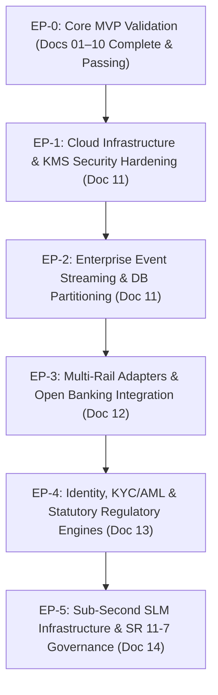

# 15 — Master Production Release, Enterprise Migration, and Verification Playbook

| Field | Value |
|---|---|
| Document | `15_MASTER_PRODUCTION_RELEASE_AND_MIGRATION_PLAYBOOK.md` |
| Version | 2.0.0-ENTERPRISE |
| Date | 10 November 2026 |
| Status | **SPECIFICATION — Enterprise Master Playbook** |
| Audience | Technical Leads, Principal Architects, Product Owners, Coding Agents |
| Bridges | Docs 01–10 (Core Foundations & Sandbox MVP) ──▶ Docs 11–14 (Tier-1 Enterprise Production) |
| Purpose | Provides the authoritative migration roadmap, release gates, and phased execution playbook to transform the core sandbox/prototype platform into a live, institutional-grade payment intelligence enterprise suite. |

---

## Table of Contents
1. [The Two-Tier Architecture Strategy](#1-the-two-tier-architecture-strategy)
2. [Complete Document Hierarchy (Docs 01–15)](#2-complete-document-hierarchy-docs-0115)
3. [Phased Enterprise Migration Roadmap (EP-0 to EP-5)](#3-phased-enterprise-migration-roadmap-ep-0-to-ep-5)
4. [Dual-Run, Shadowing & Zero-Downtime Migration](#4-dual-run-shadowing--zero-downtime-migration)
5. [Institutional Production Release Gates (PRG-01 to PRG-10)](#5-institutional-production-release-gates-prg-01-to-prg-10)
6. [Autonomous Agent Execution Rules for Enterprise Mode](#6-autonomous-agent-execution-rules-for-enterprise-mode)

---

## 1. The Two-Tier Architecture Strategy

PayBridge AI uses a **two-tier architecture strategy** to guarantee rapid time-to-market without compromising long-term institutional scalability:

```
┌─────────────────────────────────────────────────────────────────────────────────┐
│                           TIER 1: THE CORE PLATFORM                            │
│                                (Docs 01–10)                                     │
│  - Go Modular Monolith + Chi Router                                             │
│  - PostgreSQL + RLS + Transactional SQL Outbox (`SKIP LOCKED`)                  │
│  - React 18 + TypeScript + Vite + Radix UI + CSS Design Tokens                  │
│  - PayPal Sandbox Orders v2 & Payments v2 Capture                               │
│  - Core Invariants: Timeout != Failure, Provider Truth, No AI Money Mutation    │
│  - Golden Demo (Lost-Response Reconcile Proof)                                  │
└────────────────────────────────────────┬────────────────────────────────────────┘
                                         │
                                         ▼ UPGRADE PATH
┌─────────────────────────────────────────────────────────────────────────────────┐
│                     TIER 2: INSTITUTIONAL ENTERPRISE SUITE                      │
│                                (Docs 11–15)                                     │
│  - Multi-Region Active-Passive HA + Cloudflare Edge Protection (Doc 11)         │
│  - Distributed Kafka / Debezium Event Streaming (> 10,000 TPS) (Doc 11)        │
│  - AWS KMS / Vault HSM Envelope Encryption with Automated 90-Day Rotation (Doc 11)│
│  - Multi-Rail Adapters (PayPal Live, Stripe, Wise, Banking Rails) (Doc 12)      │
│  - Open Banking & Account Aggregators for Direct Bank Credit Observability (Doc 12)│
│  - RBI Purpose Codes (P0802), e-FIRC Ingestion, FinCEN Travel Rule (Doc 13)    │
│  - Enterprise IAM (Okta SAML 2.0 / OIDC, WebAuthn MFA, SCIM 2.0) (Doc 13)       │
│  - Sub-Second Hybrid SLM (vLLM) + Semantic Vector Cache + SR 11-7 (Doc 14)      │
└─────────────────────────────────────────────────────────────────────────────────┘
```

---

## 2. Complete Document Hierarchy (Docs 01–15)

| # | File | Purpose | Scope |
|---|---|---|---|
| **01** | `01_PRODUCT_BLUEPRINT_AND_MASTER_VISION.md` | Master product vision, canonical vocabulary, problem space | Core / Baseline |
| **02** | `02_CLAUDE_MASTER_IMPLEMENTATION_PROMPT.md` | Coding agent implementation prompt & execution constraints | Operating System |
| **03** | `03_SYSTEM_DESIGN_AND_ARCHITECTURE.md` | C4 architecture, trust boundaries, state machines, ADRs | Core / Baseline |
| **04** | `04_BACKEND_ENGINEERING_SPECIFICATION.md` | Go layout, PostgreSQL DDL (0001–0010), 48 API routes | Core / Baseline |
| **05** | `05_FRONTEND_PRODUCT_AND_IMPLEMENTATION_SPEC.md` | React/Vite architecture, data flow, SSE, UI contracts | Core / Baseline |
| **06** | `06_UI_UX_DESIGN_SYSTEM_AND_SCREEN_BLUEPRINT.md` | 16-screen blueprint, design tokens, wireframes, copy deck | Core / Baseline |
| **07** | `07_AI_MULTI_AGENT_ARCHITECTURE_AND_PROMPT_SPEC.md` | Agents A01–A10, orchestrator DAG, JSON schemas, evals | Core / Baseline |
| **08** | `08_PAYPAL_INTEGRATION_SECURITY_PRIVACY_AND_COMPLIANCE.md`| PayPal sandbox setup, STRIDE threat model, `.env.example` | Core / Baseline |
| **09** | `09_TESTING_DEVOPS_DEPLOYMENT_AND_RELEASE_PLAYBOOK.md`| CI/CD, Render deploy, test suites (Unit, Chaos, Privacy) | Core / Baseline |
| **10** | `10_IMPLEMENTATION_ROADMAP_ACCEPTANCE_AND_DEMO.md` | Roadmap, acceptance outcomes (AO-01 to AO-14), Demo B | Core / Baseline |
| **11** | `11_ENTERPRISE_PRODUCTION_INFRASTRUCTURE_SCALING_AND_HA.md`| Kafka streaming, multi-region failover, KMS encryption | Enterprise Tier-2 |
| **12** | `12_MULTI_RAIL_PAYMENTS_BANK_SETTLEMENT_AND_LIFECYCLE.md`| Multi-rail (Stripe/Wise), refunds/disputes, Open Banking | Enterprise Tier-2 |
| **13** | `13_REGULATORY_COMPLIANCE_KYC_AML_AND_DATA_GOVERNANCE.md`| RBI Purpose Codes, e-FIRC, Persona KYC, Okta SSO/SCIM | Enterprise Tier-2 |
| **14** | `14_ENTERPRISE_AI_SLM_GOVERNANCE_AND_SUB_SECOND_FALLBACK.md`| Sub-second SLMs, semantic cache, prompt guardrails, SR 11-7 | Enterprise Tier-2 |
| **15** | `15_MASTER_PRODUCTION_RELEASE_AND_MIGRATION_PLAYBOOK.md`| Phased migration path, release gates, enterprise agent rules | Enterprise Master |

---

## 3. Phased Enterprise Migration Roadmap (EP-0 to EP-5)

When moving beyond the initial MVP into institutional production, execute according to these sequential enterprise phases:



### Phase Details

#### Phase EP-1: Infrastructure & Key Management Hardening (Doc 11)
- Deploy multi-region Kubernetes cluster (EKS/GKE) with Cloudflare Enterprise ingress.
- Provision AWS KMS / HashiCorp Vault. Replace static `.env` encryption with envelope encryption.
- **Exit Gate**: KMS automated key rotation tested; gitleaks scan clean; zero plain secrets in memory dumps.

#### Phase EP-2: Distributed Event Streaming (Doc 11)
- Deploy Kafka 3-AZ cluster. Implement Debezium CDC on PostgreSQL `outbox_events`.
- Migrate worker consumers to Kafka consumer groups with Redis distributed locks.
- **Exit Gate**: Synthetic load test passing 10,000 TPS with zero message loss and consumer lag < 100 ms.

#### Phase EP-3: Multi-Rail & Settlement Observability (Doc 12)
- Implement Stripe and Wise provider adapters conforming to the unified Go `Reader` / `Mutator` interfaces.
- Integrate Plaid (US) and Sahamati Account Aggregator (India) for real-time deposit verification.
- **Exit Gate**: End-to-end payment moves `receiver_state` to `VERIFIED_BANK_CREDITED` using cryptographic bank data.

#### Phase EP-4: Institutional Compliance & Enterprise IAM (Doc 13)
- Integrate Okta SAML 2.0 / OIDC and SCIM 2.0 directory provisioning.
- Deploy automated KYC/KYB (Persona) and sanctions screening (ComplyAdvantage).
- Implement mandatory RBI Purpose Code tagging (P0802, etc.) and automated e-FIRC ingestion.
- **Exit Gate**: SOC 2 Type II audit readiness passed; non-compliant or sanctioned transactions blocked automatically.

#### Phase EP-5: Sub-Second AI & Model Governance (Doc 14)
- Deploy local vLLM cluster with quantized 8B model for Tier 1 triage (A01, A05).
- Deploy Redis semantic vector cache.
- Implement NeMo Guardrails, canary token injection, and SR 11-7 model risk logging.
- **Exit Gate**: P99 investigation latency < 450 ms; 100% of claims cite verified evidence; zero canary token leakage.

---

## 4. Dual-Run, Shadowing & Zero-Downtime Migration

To guarantee zero operational risk during live migration:
1. **Dark Launch / Shadow Mode**:
   - The multi-rail and streaming engines run in shadow mode alongside the primary Go backend.
   - Every provider event is simultaneously processed by both the original SQL reducer and the Kafka stream reducer.
   - An automated diff tool compares state vectors: if any discrepancy occurs, an alert triggers and the cutover halts.
2. **Blue/Green Deployment**:
   - Database migrations use backward-compatible schema changes (expand and contract pattern).
   - Traffic shifts gradually: 1% ──▶ 5% ──▶ 25% ──▶ 100% over 72 hours with automated rollback on error budget burn > 0.1%.

---

## 5. Institutional Production Release Gates (PRG-01 to PRG-10)

Before any customer transaction is routed through live production rails, all ten Institutional Release Gates must be passed and evidenced in `docs/evidence/production-signoff.md`:

| Gate ID | Area | Required Verification Evidence |
|---|---|---|
| **PRG-01** | Multi-Region Resilience | Secondary region failover completed in < 60 seconds with zero lost data (RPO < 1s). |
| **PRG-02** | Secret Security | Zero plaintext secrets; KMS envelope encryption verified with simulated HSM outage. |
| **PRG-03** | Blind-Retry Invariant | Automated chaos injection of 1,000 lost capture responses resulted in 0 duplicate payments. |
| **PRG-04** | Bank Observability | Account Aggregator cryptographic match verified; bank credit evidenced with signed statement. |
| **PRG-05** | Sanctions Enforcement | Automated block of simulated OFAC SDN identity within 100 milliseconds; SAR record generated. |
| **PRG-06** | RBI / Statutory Proof | Remittance into Indian entity correctly tagged with Purpose Code P0802; e-FIRC hash verified. |
| **PRG-07** | Enterprise SSO / SCIM | Okta SSO login enforced with WebAuthn; SCIM user deactivation instantly terminates active tokens. |
| **PRG-08** | Sub-Second AI SLA | Investigation triage latency verified at < 450 ms P99 across 500 concurrent synthetic cases. |
| **PRG-09** | Model Risk Management | Claim citation validator verified: 100% of uncited claims rejected or downgraded to unknown. |
| **PRG-10** | PCI-DSS / SOC 2 | Penetration test clean; no PAN stored; SAQ-A compliance documentation signed. |

---

## 6. Autonomous Agent Execution Rules for Enterprise Mode

When an autonomous AI coding agent (Claude Code, Google Antigravity, Devin, etc.) is instructed to build in **Enterprise Mode**:

1. **Order of Operations**:
   - The agent MUST first complete Tier 1 Core Foundations (Phases P0–P4 from Doc 02 / Doc 10).
   - Once the core invariant engine is functional, the agent adopts Docs 11–14 to upgrade the persistence, queueing, security, and payment adapters.
2. **Strict Incremental Delivery**:
   - Never implement Kafka, KMS, Multi-Rail, and Open Banking in a single code dump.
   - Use the **Task Template** (Doc 02 §19) for every enterprise task (e.g., `Task EP-1.1: KMS Envelope Client`, `Task EP-2.1: Debezium Outbox Schema`).
3. **No Simulation Impersonating Production**:
   - The agent must always tag test data with `environment = REAL_PRODUCTION` vs `REAL_SANDBOX` vs `LOCAL_SIMULATION`.
   - Never claim an enterprise release gate is passed without providing raw, reproducible test logs.
