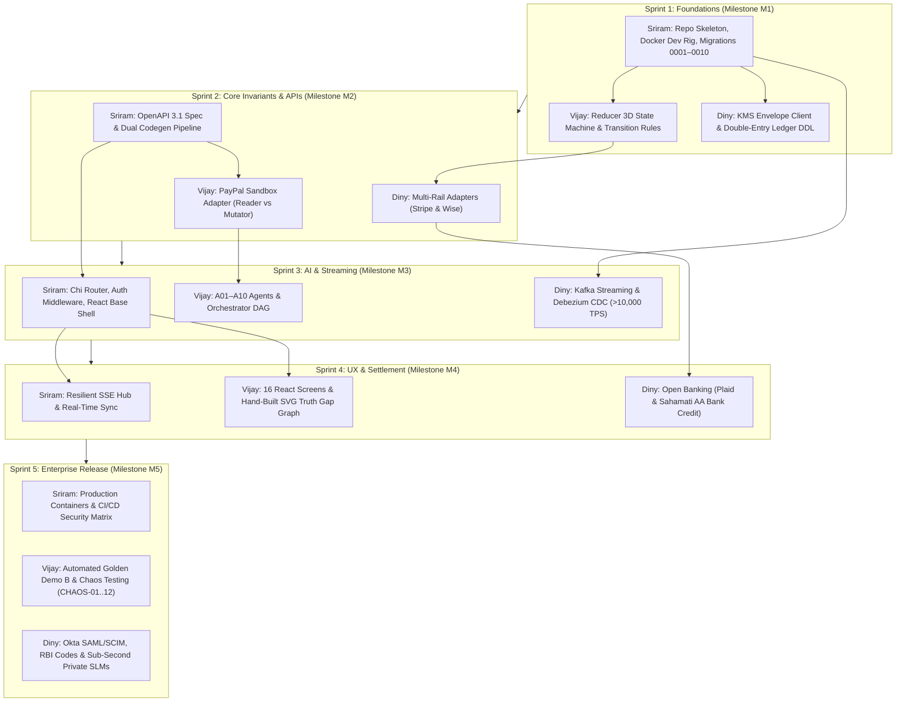

# PayBridge AI — Master Specification & Implementation Manifest

| Metric | Specification Status |
|---|---|
| **Version** | `2.0.0-ENTERPRISE` (Complete Institutional Production Suite) |
| **Date** | 10 November 2026 |
| **Platform Category** | Evidence-First Cross-Border Payment Intelligence & Safe Recovery Platform |
| **Status** | **APPROVED SPECIFICATION SUITE — READY FOR AUTONOMOUS AGENT EXECUTION** |
| **Document Directory** | 19 Master Specification Documents (Docs 01–19) |
| **Team Allocation** | Sriram (Antigravity), Vijay Kasthuri (Claude), Diny Paul (Claude & Astra) |

> **Independent Project Notice:** PayBridge AI uses PayPal Developer and partner banking APIs; it is an independent platform not affiliated with or endorsed by PayPal.

---

## 1. Executive Summary & Core Invariants

PayBridge AI solves the fundamental problem of cross-border payment ambiguity: **when an international payment times out or network responses drop, what is the authoritative financial truth, and how do we prevent dangerous blind duplicate charges?**

### Non-Negotiable System Invariants
1. **PayBridge never moves money on its own initiative, and AI NEVER moves money at all.** No prompt, LLM output, tool, or autonomous worker can initiate, capture, refund, or retry a payment.
2. **Provider evidence is financial truth; AI is not.** LLM outputs cannot modify `provider_state`, `application_state`, `receiver_state`, or `case_status`. Only deterministic Go code in the Reducer backed by cryptographic evidence can change state.
3. **Timeout ≠ Failure.** An HTTP timeout, connection reset, or 5xx gateway error is **OUTCOME-UNKNOWN** until reconciled via read-only GETs. The UI and API must never render "failed" from an ambiguous timeout.
4. **Never blind-retry a financial mutation.** Reconcile the original transaction using stable idempotent request keys (`PayPal-Request-Id`).
5. **No ungrounded claims.** 100% of confirmed statements produced by AI agents must cite verified provider evidence IDs from frozen snapshots.

---

## 2. Master Document Index (Docs 01–19)

The entire platform is organized across three modular, non-overlapping tiers:

```
┌────────────────────────────────────────────────────────────────────────────────────────┐
│                                   PAYBRIDGE AI SUITE                                   │
├────────────────────────────┬────────────────────────────┬──────────────────────────────┤
│    TIER 1: CORE ENGINE     │     TIER 2: ENTERPRISE     │    TIER 3: TEAM EXECUTION    │
│       (Docs 01–10)         │        (Docs 11–15)        │         (Docs 16–19)         │
│  • Go Monolith & Chi API   │  • Kafka Streaming (>10k)  │  • Sriram (Antigravity)      │
│  • Postgres RLS DDL (1-10) │  • AWS KMS Envelope Enc    │  • Vijay Kasthuri (Claude)   │
│  • PayPal Sandbox Capture  │  • Multi-Rail (Stripe/Wise)│  • Diny Paul (Claude/Astra)  │
│  • A01–A10 Agent DAG       │  • Open Banking & AA       │  • 5-Milestone Gantt Timeline│
│  • 16 React Screens & SVG  │  • RBI Codes, e-FIRC & KYC │  • Handshake Contracts       │
│  • Golden Demo B Reconcile │  • Sub-sec SLMs & SR 11-7  │  • Zero-Conflict Git Matrix  │
└────────────────────────────┴────────────────────────────┴──────────────────────────────┘
```

### Complete Document Catalog

| # | File Name | Document Title & Purpose | Target Agent / Assignee |
|---|---|---|---|
| **01** | [`01_PRODUCT_BLUEPRINT_AND_MASTER_VISION.md`](file:///d:/Projects/krs-question-paper-tool/files%20(1)/01_PRODUCT_BLUEPRINT_AND_MASTER_VISION.md) | **Product Truth & Master Vision**<br>Canonical vocabulary, 3D state vector, problem taxonomy, acceptance outcomes (AO-01 to 14), decision log. | All Engineers & Agents |
| **02** | [`02_CLAUDE_MASTER_IMPLEMENTATION_PROMPT.md`](file:///d:/Projects/krs-question-paper-tool/files%20(1)/02_CLAUDE_MASTER_IMPLEMENTATION_PROMPT.md) | **Master Coding Agent Operating Prompt**<br>Standalone copy-paste system prompt, prime directives, bounded task templates, and safety stop conditions. | All Coding Agents |
| **03** | [`03_SYSTEM_DESIGN_AND_ARCHITECTURE.md`](file:///d:/Projects/krs-question-paper-tool/files%20(1)/03_SYSTEM_DESIGN_AND_ARCHITECTURE.md) | **C4 Architecture & System Design**<br>C4 Level 1–3 diagrams, trust boundaries (TB0–TB3), 10 sequence diagrams (S1–S10), state machines, ADRs. | System Architects |
| **04** | [`04_BACKEND_ENGINEERING_SPECIFICATION.md`](file:///d:/Projects/krs-question-paper-tool/files%20(1)/04_BACKEND_ENGINEERING_SPECIFICATION.md) | **Go Backend Engineering Specification**<br>Package layout, `depguard` import rules, 10 PostgreSQL migrations (DDL), 48 API routes, Safe Action Engine. | Sriram & Vijay |
| **05** | [`05_FRONTEND_PRODUCT_AND_IMPLEMENTATION_SPEC.md`](file:///d:/Projects/krs-question-paper-tool/files%20(1)/05_FRONTEND_PRODUCT_AND_IMPLEMENTATION_SPEC.md) | **Frontend Architecture Specification**<br>React 18 + TypeScript + Vite contract, TanStack Query architecture, route map, SSE hub, real-vs-fixture policy. | Sriram & Vijay |
| **06** | [`06_UI_UX_DESIGN_SYSTEM_AND_SCREEN_BLUEPRINT.md`](file:///d:/Projects/krs-question-paper-tool/files%20(1)/06_UI_UX_DESIGN_SYSTEM_AND_SCREEN_BLUEPRINT.md) | **Design System & 16-Screen Blueprint**<br>Design tokens, layout grammar, 16 complete screen wireframes, calm copy deck, a11y standards. | Vijay Kasthuri |
| **07** | [`07_AI_MULTI_AGENT_ARCHITECTURE_AND_PROMPT_SPEC.md`](file:///d:/Projects/krs-question-paper-tool/files%20(1)/07_AI_MULTI_AGENT_ARCHITECTURE_AND_PROMPT_SPEC.md) | **AI Multi-Agent Architecture (A01–A10)**<br>Fixed DAG orchestrator, 10 specialist agent prompts, JSON schemas, Claim Validator, prompt injection defense. | Vijay Kasthuri |
| **08** | [`08_PAYPAL_INTEGRATION_SECURITY_PRIVACY_AND_COMPLIANCE.md`](file:///d:/Projects/krs-question-paper-tool/files%20(1)/08_PAYPAL_INTEGRATION_SECURITY_PRIVACY_AND_COMPLIANCE.md) | **PayPal Sandbox, Security & Privacy**<br>Sandbox setup, STRIDE threat model, OWASP API mapping, privacy matrix, authoritative `.env.example`. | Sriram & Diny |
| **09** | [`09_TESTING_DEVOPS_DEPLOYMENT_AND_RELEASE_PLAYBOOK.md`](file:///d:/Projects/krs-question-paper-tool/files%20(1)/09_TESTING_DEVOPS_DEPLOYMENT_AND_RELEASE_PLAYBOOK.md) | **Testing, DevOps & Release Playbook**<br>CI/CD pipelines, Docker Compose, simulator, chaos testing (CHAOS-01 to 12), Render hosting runbooks. | Sriram |
| **10** | [`10_IMPLEMENTATION_ROADMAP_ACCEPTANCE_AND_DEMO.md`](file:///d:/Projects/krs-question-paper-tool/files%20(1)/10_IMPLEMENTATION_ROADMAP_ACCEPTANCE_AND_DEMO.md) | **Roadmap, Acceptance Gates & Golden Demo**<br>Phases P0 to P8, task breakdown (T0.1 to T8.x), Golden Demo B script, honest claims checklist. | Technical Leads |
| **11** | [`11_ENTERPRISE_PRODUCTION_INFRASTRUCTURE_SCALING_AND_HA.md`](file:///d:/Projects/krs-question-paper-tool/files%20(1)/11_ENTERPRISE_PRODUCTION_INFRASTRUCTURE_SCALING_AND_HA.md) | **Enterprise Infrastructure, Kafka & KMS**<br>Distributed Kafka event bus (>10,000 TPS), multi-region active-passive failover, AWS KMS envelope encryption. | Diny Paul |
| **12** | [`12_MULTI_RAIL_PAYMENTS_BANK_SETTLEMENT_AND_LIFECYCLE.md`](file:///d:/Projects/krs-question-paper-tool/files%20(1)/12_MULTI_RAIL_PAYMENTS_BANK_SETTLEMENT_AND_LIFECYCLE.md) | **Multi-Rail Payments & Bank Observability**<br>PayPal Live, Stripe, Wise, Open Banking (Plaid) & Account Aggregators (Sahamati AA), refunds & disputes. | Diny Paul |
| **13** | [`13_REGULATORY_COMPLIANCE_KYC_AML_AND_DATA_GOVERNANCE.md`](file:///d:/Projects/krs-question-paper-tool/files%20(1)/13_REGULATORY_COMPLIANCE_KYC_AML_AND_DATA_GOVERNANCE.md) | **Regulatory Compliance, KYC/AML & IAM**<br>RBI Purpose Codes (P0802), e-FIRC ingestion, Persona KYC/KYB, ComplyAdvantage sanctions, Okta SAML/SCIM. | Diny Paul |
| **14** | [`14_ENTERPRISE_AI_SLM_GOVERNANCE_AND_SUB_SECOND_FALLBACK.md`](file:///d:/Projects/krs-question-paper-tool/files%20(1)/14_ENTERPRISE_AI_SLM_GOVERNANCE_AND_SUB_SECOND_FALLBACK.md) | **Enterprise AI, Private SLMs & Model Risk**<br>Sub-second triage (<450ms P99) via private vLLM SLMs, Redis semantic vector cache, canary tokens, SR 11-7. | Diny Paul & Vijay |
| **15** | [`15_MASTER_PRODUCTION_RELEASE_AND_MIGRATION_PLAYBOOK.md`](file:///d:/Projects/krs-question-paper-tool/files%20(1)/15_MASTER_PRODUCTION_RELEASE_AND_MIGRATION_PLAYBOOK.md) | **Master Production Release & Migration**<br>Enterprise rollout phases (EP-0 to EP-5), dual-run shadowing, 10 production release gates (PRG-01 to 10). | Technical Leads |
| **16** | [`16_TEAM_WORK_ALLOCATION_AND_TIMELINE_MASTER.md`](file:///d:/Projects/krs-question-paper-tool/files%20(1)/16_TEAM_WORK_ALLOCATION_AND_TIMELINE_MASTER.md) | **Team 3-Member Coordination & Timeline**<br>Cross-team dependency matrix, 5-milestone Gantt schedule, interface handshake contracts, zero-conflict git rules. | Sriram, Vijay, Diny |
| **17** | [`17_SRIRAM_ANTIGRAVITY_EXECUTION_AND_PROMPT_DECK.md`](file:///d:/Projects/krs-question-paper-tool/files%20(1)/17_SRIRAM_ANTIGRAVITY_EXECUTION_AND_PROMPT_DECK.md) | **Sriram Antigravity Execution Deck**<br>Tasks S1–S7: Docker, DB Migrations 0001–0010, OpenAPI 3.1, Chi HTTP server, CI/CD, React shell + Antigravity Mega Prompt. | Sriram (Antigravity) |
| **18** | [`18_VIJAY_KASTHURI_CLAUDE_EXECUTION_AND_PROMPT_DECK.md`](file:///d:/Projects/krs-question-paper-tool/files%20(1)/18_VIJAY_KASTHURI_CLAUDE_EXECUTION_AND_PROMPT_DECK.md) | **Vijay Kasthuri Claude Execution Deck**<br>Tasks V1–V7: 3D Reducer, PayPal Sandbox Adapter, Safe Action Engine, A01–A10 Orchestrator, 16 Screens + Claude Mega Prompt. | Vijay (Claude) |
| **19** | [`19_DINY_PAUL_CLAUDE_ASTRA_EXECUTION_AND_PROMPT_DECK.md`](file:///d:/Projects/krs-question-paper-tool/files%20(1)/19_DINY_PAUL_CLAUDE_ASTRA_EXECUTION_AND_PROMPT_DECK.md) | **Diny Paul Claude & Astra Execution Deck**<br>Tasks D1–D7: Kafka/Debezium (>10k TPS), KMS Envelope Encryption, Multi-Rail, Open Banking, RBI Codes, Okta + Astra Mega Prompt. | Diny (Claude/Astra) |

---

## 3. Team Member Quick-Start Guide

Each team member has a dedicated, self-contained prompt and execution deck containing full task instructions and copy-paste-ready agent prompts:

### Member 1: Sriram (Google Antigravity)
* **Pillar:** Platform Foundations, Docker Dev Rig, DB Migrations, Core Chi API & Base React Shell.
* **Open Document:** [`17_SRIRAM_ANTIGRAVITY_EXECUTION_AND_PROMPT_DECK.md`](file:///d:/Projects/krs-question-paper-tool/files%20(1)/17_SRIRAM_ANTIGRAVITY_EXECUTION_AND_PROMPT_DECK.md)
* **Prompt to Paste:** Lines 39–80 into Google Antigravity.
* **Immediate Tasks:** Task S1 (Monorepo skeleton & Compose), Task S2 (Config guard), Task S3 (Migrations 0001–0010).

### Member 2: Vijay Kasthuri (Anthropic Claude)
* **Pillar:** 3D State Reducer, PayPal Sandbox Adapter, A01–A10 Orchestrator, Claim Validator & 16 React Screens.
* **Open Document:** [`18_VIJAY_KASTHURI_CLAUDE_EXECUTION_AND_PROMPT_DECK.md`](file:///d:/Projects/krs-question-paper-tool/files%20(1)/18_VIJAY_KASTHURI_CLAUDE_EXECUTION_AND_PROMPT_DECK.md)
* **Prompt to Paste:** Lines 39–80 into Claude Code / Claude 3.5 Sonnet.
* **Immediate Tasks:** Task V1 (Go Reducer state machine), Task V2 (PayPal Reader/Mutator adapter), Task V3 (Safe Action Engine).

### Member 3: Diny Paul (Claude & Astra)
* **Pillar:** Enterprise Event Streaming, AWS KMS Envelope Encryption, Multi-Rail, Open Banking & Statutory Compliance.
* **Open Document:** [`19_DINY_PAUL_CLAUDE_ASTRA_EXECUTION_AND_PROMPT_DECK.md`](file:///d:/Projects/krs-question-paper-tool/files%20(1)/19_DINY_PAUL_CLAUDE_ASTRA_EXECUTION_AND_PROMPT_DECK.md)
* **Prompt to Paste:** Lines 39–82 into Claude / Astra.
* **Immediate Tasks:** Task D1 (Kafka 32-partition streaming bus), Task D2 (KMS Envelope client), Task D3 (Stripe/Wise multi-rail).

---

## 4. End-to-End Execution Sequence



---

## 5. Master Verification Commands

Before signing off on any pull request or milestone, execute the joint verification suite:

```bash
# 1. Full Go Compilation & Unit Tests (Strict Race Detector Enabled)
go test -v -race ./services/api/...

# 2. Architectural Package Boundary Verification (Depguard)
go test -v ./services/api/internal/archtest/...

# 3. Automated Secret Scanning (Zero Credentials in Git)
gitleaks detect --source . --verbose

# 4. Frontend Type Checking & Production Build
cd apps/web && tsc --noEmit && npm run build

# 5. Contract Drift Check
git diff --exit-code packages/contracts/openapi.yaml
```

*All 19 documents in this directory are authoritative and cross-referenced. Start work by following the prompts in Docs 17, 18, and 19.*
